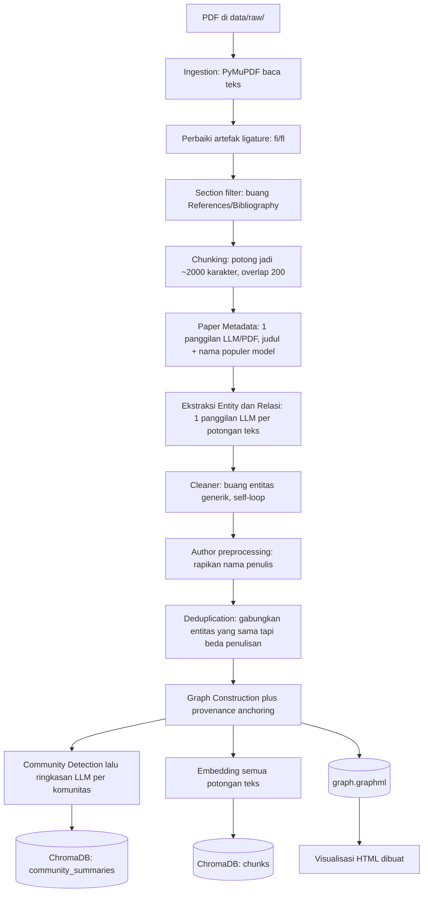
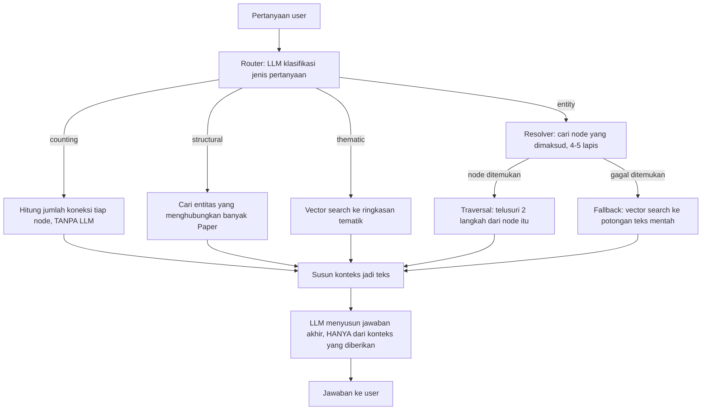

# GraphRAG Paper Explorer — Laporan Teknis & Bahan Belajar

> Sistem tanya-jawab akademik berbasis **Knowledge Graph + Vector Retrieval** di atas korpus
> paper tentang *sycophancy* pada Large Language Model (LLM), dengan visualisasi graf
> interaktif dan chatbot web.
> Constraint utama: **budget $0** (tanpa cloud berbayar, seluruh embedding berjalan lokal).

**Cara membaca dokumen ini:** dokumen ini ditulis rangkap dua — sebagai laporan teknis **dan**
sebagai bahan belajar. Setiap kali istilah teknis baru muncul pertama kali, ada kotak
**📘 Penjelasan** yang menerangkannya dari nol. Kalau Anda sudah paham suatu istilah, lewati saja
kotaknya. Tujuannya supaya Anda bisa mempresentasikan dokumen ini **memahami setiap kalimat**,
bukan menghafal.

**Status akhir (per 2026-08-03):**
- Graph: **440 node / 525 edge**, 1 connected component, 0 node terisolasi
- Korpus: **8 paper** tentang *sycophancy* (perilaku AI yang cenderung menjilat/menyetujui user
  daripada jujur)
- Evaluasi: **retrieval 94%** (29/31 kasus), **end-to-end 90%** (35/39 kasus),
  **anti-halusinasi 8/8** (sistem tidak pernah mengarang jawaban)

---

## 📘 Penjelasan: Istilah Fundamental (baca ini dulu kalau baru masuk AI)

Sebelum masuk ke detail, ini lima istilah yang akan muncul berulang-ulang di seluruh dokumen.

| Istilah | Penjelasan sederhana |
|---|---|
| **LLM** (Large Language Model) | Model AI yang dilatih membaca miliaran teks, sehingga bisa memahami & menghasilkan bahasa manusia. Contoh: GPT-4, Gemini, Claude. Proyek ini memakai **Gemini** (dari Google) untuk semua tugas yang butuh "pemahaman bahasa" — mengekstrak informasi, menjawab pertanyaan, dll. |
| **Embedding** | Cara mengubah teks jadi **deretan angka** (vektor) sehingga makna teks bisa dibandingkan secara matematis. Teks yang maknanya mirip akan punya angka yang "berdekatan". Contoh: embedding kata "mobil" akan lebih dekat ke "kendaraan" daripada ke "apel". Ini yang memungkinkan komputer mencari teks berdasarkan **makna**, bukan cuma kata yang sama persis. |
| **Vector Database / Vector Search** | Basis data yang menyimpan embedding, lalu bisa dicari "teks mana yang maknanya paling mirip dengan pertanyaan saya?" secara cepat. Proyek ini pakai **ChromaDB**. |
| **RAG** (Retrieval-Augmented Generation) | Pola umum di aplikasi LLM: alih-alih LLM menjawab dari "ingatan" pelatihannya (yang bisa salah/mengarang), sistem **mengambil dulu (retrieve)** potongan teks relevan dari dokumen asli, baru LLM **menghasilkan (generate)** jawaban berdasarkan potongan itu. Ini mengurangi *halusinasi* (LLM mengarang jawaban). |
| **Knowledge Graph** (Graf Pengetahuan) | Cara merepresentasikan pengetahuan sebagai **node** (entitas/benda — mis. "GPT-4o", "Stanford University") yang dihubungkan oleh **edge** (relasi — mis. "ditulis oleh", "berafiliasi dengan"). Berbeda dari tabel database biasa, graf secara alami merepresentasikan **hubungan**, sehingga bisa "ditelusuri" (mis. Paper → Author → Institution). |

**GraphRAG** = menggabungkan Knowledge Graph dengan RAG. Ini konsep intinya proyek ini, dan
akan dijelaskan detail di §1.3 setelah Anda paham istilah dasarnya.

---

## 1. Latar Belakang & Masalah

### 1.1 Konteks

Proyek ini adalah **iterasi kedua** (V2.0) dari sebuah paper explorer. Versi pertama (V1) sudah
bisa mengekstrak isi paper menjadi graf, tetapi **tidak memiliki vector search sama sekali** —
resolusi entitas (mencari "paper mana / entitas mana yang dimaksud user") murni berbasis
pencocokan string. V2.0 dibangun ulang secara khusus untuk **menggabungkan graf dengan
vector retrieval (RAG)**.

**Korpus saat ini** (per 2026-08-03): **8 paper riset tentang *sycophancy* pada LLM** — yaitu
kecenderungan AI untuk terlalu menyetujui/memuji pengguna daripada memberi jawaban yang jujur
dan objektif (analoginya: asisten yang "menjilat" alih-alih kritis). Ini topik riset AI safety
yang sedang aktif di 2025-2026. Judul-judulnya:

1. *Towards Understanding Sycophancy in Language Models*
2. *SycEval: Evaluating LLM Sycophancy*
3. *Be Friendly, Not Friends: How LLM Sycophancy Shapes User Trust*
4. *ELEPHANT: Measuring and Understanding Social Sycophancy in LLMs*
5. *EchoBench: Benchmarking Sycophancy in Medical Large Vision-Language Models*
6. *Beacon: Single-Turn Diagnosis and Mitigation of Latent Sycophancy in LLMs*
7. *What Counts as AI Sycophancy? A Taxonomy and Expert Survey*
8. *Warning Labels Shift Perceptions of Sycophantic AI, But Not Its Influence*

> Catatan penting: proyek ini **sempat berganti korpus** di tengah pengembangan — semula
> memakai 5 paper arsitektur CNN klasik (ResNet, VGG, dll.), lalu diganti ke 8 paper sycophancy
> ini. Korpus lama disimpan utuh (via tool `corpus.py` yang dibuat khusus, lihat §6.7) sehingga
> bisa dipulihkan kapan saja tanpa build ulang. Pergantian ini justru jadi **uji nyata**
> generalisasi sistem — apakah pipeline yang dibangun untuk satu domain (computer vision) tetap
> bekerja di domain lain (AI safety) tanpa mengubah kode. Hasilnya: **ya**, kecuali dua bagian
> yang memang di-hardcode untuk korpus lama, yang lalu diperbaiki (lihat §6.5 "de-hardcoding").

### 1.2 Masalah yang ingin diselesaikan

Membaca dan mensintesis banyak paper secara manual itu mahal waktu. Tiga jenis pertanyaan yang
**paling sering muncul saat literature review** justru paling sulit dijawab oleh chatbot LLM biasa:

| Jenis pertanyaan | Contoh nyata dari korpus ini | Kenapa sulit untuk LLM biasa |
|---|---|---|
| **Agregatif** (hitung/ranking) | "Metode apa yang paling banyak dipakai di seluruh paper?" | LLM biasa hanya melihat beberapa potongan teks yang "mirip" pertanyaan — ia tidak bisa menghitung **seluruh korpus** sekaligus |
| **Relasional** (hubungan eksplisit) | "Institusi apa yang menaungi penulis paper ELEPHANT?" | Butuh menelusuri **rantai** Paper→Author→Institution — bukan sekadar mencari teks yang mirip |
| **Lintas-dokumen** | "Model apa yang diuji bersama di banyak paper?" | Butuh melihat pola **di seluruh graf**, tak bisa dari satu potongan teks |

### 1.3 Kenapa pendekatan "Graph + RAG" (bukan RAG biasa saja)

**RAG biasa** (lihat kotak penjelasan di atas) bekerja begini: pertanyaan di-embedding →
dicari potongan teks paling mirip di vector database → potongan itu dikasih ke LLM untuk
dijawab. Ini **bagus untuk pertanyaan faktual sederhana**, tapi buta terhadap ketiga jenis
pertanyaan di atas, karena ia tidak punya struktur — hanya "tumpukan potongan teks yang mirip".

**Knowledge Graph** mengatasi ini karena:
1. **Relasi jadi eksplisit.** `written_by`, `affiliated_with`, `uses_dataset` tersimpan sebagai
   edge bertipe — bisa **ditelusuri** langkah demi langkah (disebut *multi-hop traversal*,
   dijelaskan di §3).
2. **Agregasi jadi deterministik.** "Metode paling banyak dipakai" dihitung dari jumlah koneksi
   (*degree*) di graf — **tanpa LLM sama sekali**, jadi tidak mungkin salah/mengarang untuk
   pertanyaan jenis ini.
3. **Bisa divisualisasikan** — graf bisa dilihat & dijelajahi manusia, beda dengan "tumpukan
   vektor" yang tak terlihat.

Tapi **graf saja juga tidak cukup** (pelajaran dari V1): kalau kata yang dipakai user berbeda
dari kata di graf (misal user menulis "kerangka pembelajaran residual" padahal node-nya bernama
"ResNet"), resolusi berbasis string murni akan gagal total. Karena itu sistem ini bersifat
**hybrid**: graf untuk struktur & fakta presisi, vector search untuk *fleksibilitas bahasa* dan
sebagai jaring pengaman kalau graf tidak punya jawabannya.

---

## 2. Fungsi & Use Case

### 2.1 Kemampuan sistem

**A. Tanya-jawab** — pertanyaan pengguna otomatis diarahkan ke salah satu dari 4 "mesin"
berbeda oleh komponen bernama **router**:

| Intent (jenis pertanyaan) | Contoh | Mesin yang menjawab |
|---|---|---|
| `entity` | "Dataset apa yang dipakai SycEval?" | Cari node di graf → telusuri koneksinya |
| `counting` | "Metrik apa yang paling umum?" | Hitung jumlah koneksi tiap node (**tanpa LLM**) |
| `structural` | "Entitas apa yang jadi jembatan antar paper?" | Analisis pola graf lintas-dokumen |
| `thematic` | "Apa tema besar riset ini?" | Vector search ke ringkasan tematik (community) |

📘 **Penjelasan "router":** ini komponen yang membaca pertanyaan Anda dan memutuskan jalur
mana yang dipakai — mirip resepsionis yang mengarahkan Anda ke loket yang tepat. Router-nya
sendiri adalah 1 pemanggilan LLM kecil yang tugasnya **hanya mengklasifikasi**, bukan menjawab.

**B. Visualisasi graf interaktif** — satu file HTML mandiri (bisa dibuka tanpa server) berisi:
- **Legend & highlight** — klik tipe entitas untuk menyorotnya
- **Network Insights** — Top-5 entitas per kategori berdasarkan jumlah koneksi
- **Top Entity Families** — model/dataset yang punya banyak varian versi (lihat §6.6, fitur baru)
- **Edge Filters** — filter graf per jenis relasi
- **Path Discovery** — cari jalur terpendek antar dua node (BFS)
- **Search + Info Panel** — cari node, lihat detailnya, navigasi berantai antar node terhubung

**C. Chatbot web** — server (`server.py`) menyajikan visualisasi + endpoint chat, memakai
pipeline yang **sama persis** dengan CLI.

### 2.2 Target pengguna & skenario

Peneliti/mahasiswa yang melakukan literature review pada satu bidang riset. Skenario nyata
dengan korpus ini:

1. **Orientasi domain cepat.** Buka visualisasi → node besar (hub) langsung terlihat →
   tahu paper mana yang paling banyak dirujuk/dibandingkan.
2. **Menelusuri afiliasi & kolaborasi.** "Institusi apa yang menaungi penulis paper ELEPHANT?"
   → sistem menelusuri Paper→Author→Institution dan menjawab **empat institusi sekaligus**
   (lihat jawaban lengkap di §9.4).
3. **Melihat lanskap model yang diuji.** "Versi GPT apa saja yang diuji dalam paper-paper ini?"
   → sistem mengenali bahwa GPT punya banyak varian (GPT-4o, GPT-5, ChatGPT-4, dst.) yang
   tersebar di 8 paper, dan menjawab list-nya (detail di §6.6).

---

## 3. Arsitektur & Alur Kerja (Pipeline)

Sistem punya **dua pipeline terpisah**: *build* (dijalankan sekali per korpus, offline) dan
*query* (dijalankan tiap pertanyaan, online).

### 3.1 Build Pipeline



**Tahapan detail (dengan alasan tiap keputusan):**

| # | Tahap | Apa & Kenapa |
|---|---|---|
| 1 | **Ingestion** | PyMuPDF membaca teks dari PDF. Ligature Unicode (`fi`, `fl` — glyph gabungan yang sering muncul di PDF akademik) dinormalkan ke `fi`/`fl` biasa, supaya nama entitas tidak rusak (mis. "classification" → "classification") |
| 2 | **Section filter** | References/Bibliography/Acknowledgements **dibuang sebelum** teks dipotong-potong. Kenapa: bagian ini isinya daftar sitasi (nama author dari paper *lain*, bukan paper ini) — kalau ikut diekstrak, akan mengotori graf dengan entitas yang salah konteks |
| 3 | **Paper metadata** | 1 panggilan LLM per PDF untuk mengekstrak **judul resmi** + **nama populer** model yang diperkenalkan paper itu (mis. paper "SycEval: Evaluating LLM Sycophancy" → nama populer "SycEval"). Kenapa perlu: paper akademik **jarang menyebut nama populer dirinya sendiri** di teks isi — LLM perlu memakai *pengetahuan umum*-nya untuk tahu itu |
| 4 | **Extraction** | Ini jantung sistem — 1 panggilan LLM per potongan teks (*chunk*), dengan instruksi ketat (*structured output*, dijelaskan di §5) untuk mengekstrak entitas & relasi sesuai schema tetap |
| 5 | **Cleaning** | Buang entitas generik ("the model", "our approach" — istilah yang tidak merujuk apa pun spesifik) dan relasi yang salah satu ujungnya sudah terbuang |
| 6 | **Author preprocessing** | Rapikan nama penulis secara mekanis (regex, bukan LLM): buang `" et al."`, pecah `"He & Zhang"` jadi dua entitas terpisah |
| 7 | **Deduplication** | Lihat §3.3 — ini yang paling rumit, dijelaskan terpisah |
| 8 | **Graph construction** | Bangun graf dari entitas+relasi yang sudah bersih, plus "jangkarkan" tiap entitas ke Paper sumbernya (lihat §6.2 untuk cerita kenapa ini penting) |
| 9 | **Community + vector** | Kelompokkan node jadi "komunitas tematik" (lihat §3.5), lalu embed semua chunk teks ke ChromaDB untuk vector search |

### 3.2 Query Pipeline



**Poin paling penting dari alur ini:** untuk pertanyaan `counting`, **LLM tidak dilibatkan sama
sekali dalam menghitung** — hanya untuk memformulasikan kalimat jawabannya. Ini membuat
pertanyaan agregatif **tidak mungkin salah hitung/berhalusinasi**, karena angkanya datang dari
kode Python biasa (`GraphAnalytics.get_counting_stats`), bukan tebakan LLM.

### 3.3 Deduplication — masalah paling rumit di seluruh sistem

📘 **Kenapa ini rumit:** kalau paper A menyebut "DenseNet" dan paper B menyebut "Dense
Convolutional Network", keduanya merujuk hal yang **sama** — tapi secara string, beda total.
Kalau sistem gagal menyadari ini, graf akan punya **dua node terpisah** untuk konsep yang sama,
memecah informasi jadi tercerai-berai.

Solusinya 4 lapis berurutan (tiap lapis hanya dipakai kalau lapis sebelumnya tidak menemukan
kecocokan):

```
Entity kandidat baru
  ├─ 0. Sudah pernah diproses persis sama?             → langsung pakai hasil lama
  ├─ 1. Exact match (huruf besar/kecil diabaikan)
  ├─ 2. Normalisasi (buang tanda baca + cek kamus akronim)     → TANPA LLM
  ├─ 3. Embedding cosine similarity ≥ 0.85 (lokal, gratis)     → kandidat
  └─ 4. Konfirmasi LLM (khusus kandidat dari lapis 3)
```

📘 **Penjelasan "cosine similarity":** ini cara mengukur seberapa mirip dua embedding
(vektor angka). Nilainya 0–1: makin dekat ke 1, makin mirip maknanya. Threshold **0,85**
dipilih bukan asal — diturunkan dari **pengukuran nyata** terhadap distribusi similarity di
korpus ini (paraphrase asli biasanya skor 0,72–0,97; teks yang tak berhubungan skor 0,54–0,64).

**Dua guard penting** di lapis konfirmasi LLM (hasil pembelajaran dari kesalahan nyata di iterasi
sebelumnya):
- **CRITICAL 1:** dilarang menggabungkan entitas yang beda **angka/versi** — `ResNet-44` dan
  `ResNet-56` itu **arsitektur berbeda**, meski namanya sangat mirip secara embedding.
- **CRITICAL 2:** dilarang *hypernymy* — memetakan yang spesifik ke yang lebih umum (mis.
  "Top-1 Error" jangan digabung ke "Classification Error").

**Namespace per tipe:** entitas hanya dibandingkan dengan entitas **bertipe sama**. Author tidak
akan pernah dibandingkan dengan Method, dst. Ini mencegah kesalahan gabung lintas-kategori.

### 3.4 Resolver — bagaimana graf "mengerti" pertanyaan bahasa natural

Ini komponen paling banyak di-iterasi selama pengembangan (lihat §6.3–6.4 untuk cerita
lengkapnya). Bentuk akhirnya:

```
Query user
  ├─ 0. Konteks-paper: kalau tanya "penulis/institusi/temuan paper X" → cari node PAPER-nya
  ├─ 1. Exact match nama node
  ├─ 1.5 Kecocokan judul Paper SEBAGIAN (≥2 kata cocok, rasio ≥55%)
  ├─ 2. Nama node ditemukan verbatim DI DALAM query (mendukung >1 entitas sekaligus)
  ├─ 3. Fuzzy string match (toleransi typo kecil)
  └─ 4. Vector-native: node terdekat secara EMBEDDING (menangkap makna, bukan cuma ejaan)
       └─ semua gagal → fallback ke vector search di potongan teks mentah
```

Lapis 4 adalah **inti filosofi "GraphRAG"**: vector search dipakai untuk **masuk** ke dalam
graf (menemukan node yang tepat meski katanya beda), bukan untuk **menggantikan** graf.

### 3.5 Apa itu "Community" (untuk jalur `thematic`)

📘 **Penjelasan:** community detection adalah algoritma yang mengelompokkan node-node di graf
yang "rapat" terhubung satu sama lain jadi satu kelompok — seperti mendeteksi "klik pertemanan"
di jejaring sosial. Sistem ini pakai algoritma **Louvain**. Tiap kelompok besar lalu diringkas
oleh LLM jadi 1 paragraf tema, dan ringkasan itu di-embed untuk pencarian tematik.

Contoh nyata dari korpus ini (community #1):
> *"This group of entities represents collaborative academic and industry research focused on
> AI safety, alignment, and governance, particularly originating from or closely tied to the
> interface between top-tier academia (the University of Oxford) and leading AI frontier labs
> (Anthropic)..."*

---

## 4. Struktur Graph

### 4.1 Schema (skema tetap — 9 tipe node, 12 tipe relasi)

Skema ini **tidak berubah** meski korpus berganti total dari CNN ke sycophancy — bukti bahwa
desainnya cukup umum untuk domain akademik apa pun.

**9 tipe node**, dengan jumlah aktual di korpus sekarang:

| Tipe | Makna | Jumlah |
|---|---|---|
| `Paper` | Paper sumber di korpus | 8 |
| `Author` | Penulis paper | 68 |
| `Institution` | Universitas/lab/perusahaan | 29 |
| `Method` | Teknik, model, arsitektur, algoritma | 184 |
| `Dataset` | Dataset/benchmark bernama | 34 |
| `Metric` | Ukuran evaluasi | 27 |
| `Finding` | Temuan/klaim utama | 60 |
| `Limitation` | Kelemahan yang diakui penulis | 14 |
| `Task` | Problem yang dikerjakan | 16 |

**12 tipe relasi**, dengan jumlah aktual:

| Relasi | Jumlah | | Relasi | Jumlah |
|---|---|---|---|---|
| `mentioned_in` | 151 | | `uses_dataset` | 30 |
| `uses_method` | 82 | | `uses_metric` | 19 |
| `written_by` | 74 | | `affiliated_with` | 36 |
| `variant_of` | 43 | | `has_limitation` | 14 |
| `finds` | 45 | | `compares` | 2 |
| `proposes_method` | 28 | | `builds_on` | 1 |

> **Catatan penting soal `mentioned_in`:** ini relasi *provenance* (penanda "entitas ini
> disebut di paper ini") yang **dikecualikan** dari perhitungan ranking/degree, supaya tidak
> menggelembungkan angka koneksi secara artifisial. `variant_of` adalah relasi baru (lihat
> §6.6) yang menautkan varian versi model ke node "keluarga"-nya (mis. `GPT-4o` → `GPT`).

### 4.2 Kenapa `compares` sangat rendah (2 dari 525 edge)

Ini temuan penting dari investigasi (§6.5 & §11.2): korpus lama (CNN) punya 31 relasi
`compares`, korpus ini cuma 2. **Bukan bug** — investigasi mendalam menemukan bahwa paper-paper
modern ini menyajikan perbandingan model sebagai **grafik/chart visual** (bar chart), bukan
tabel teks. Data grafik tidak punya representasi tekstual di file PDF sama sekali — nilainya
tersimpan sebagai panjang garis vektor gambar, bukan angka yang bisa dibaca teks. Detail lengkap
investigasinya di §11.2.

### 4.3 Graph store — keputusan desain: bukan database khusus

Sistem ini **tidak** memakai graph database (seperti Neo4j). Yang dipakai: **NetworkX**
(library Python untuk manipulasi graf in-memory) + **GraphML** (format file untuk
menyimpannya ke disk).

📘 **Kenapa bukan Neo4j/database khusus:** untuk graf berukuran ratusan node (seperti di sini),
NetworkX di memori komputer jauh lebih sederhana — tidak perlu instalasi server database
terpisah, dan semua algoritma yang dibutuhkan (BFS untuk traversal, Louvain untuk community,
dll.) sudah tersedia built-in. Trade-off-nya: **tidak scalable** untuk graf berukuran jutaan
node (dibahas di §11.2).

---

## 5. Teknologi (Stack) & Alasan Pemilihan

| Komponen | Teknologi | Kenapa dipilih |
|---|---|---|
| **LLM** | Google **Gemini Flash Lite** | Free tier tanpa kartu kredit (constraint $0 hard requirement) |
| **Structured output** | **Pydantic v2** | Memaksa LLM mengembalikan JSON sesuai skema yang pasti (bukan teks bebas yang rawan salah parse). Field `Literal` di Pydantic membuat LLM **hanya bisa** memilih dari 9 tipe entitas/12 tipe relasi yang sudah ditentukan |
| **Embedding** | `sentence-transformers`, model `BAAI/bge-small-en-v1.5` | Berjalan **lokal di CPU** → gratis, tanpa batas panggilan. (Catatan: model ini khusus Bahasa Inggris — dibahas sebagai limitasi di §11.2) |
| **Vector store** | **ChromaDB** | Vector database yang bisa berjalan tanpa server terpisah (embedded), menyimpan data langsung ke disk |
| **Graph** | **NetworkX** + GraphML | Lihat §4.3 |
| **Community detection** | Algoritma **Louvain** (built-in NetworkX) | Standar untuk mendeteksi kelompok padat di graf, sudah tersedia tanpa dependensi tambahan |
| **PDF parsing** | **PyMuPDF** (`fitz`) | Cepat, dan menyediakan API `find_tables()` untuk deteksi tabel (dipakai saat investigasi §11.2) |
| **Visualisasi** | **Pyvis** (wrapper untuk library JavaScript `vis.js`) | Menghasilkan satu file HTML mandiri yang bisa dibuka tanpa server |
| **Web server** | **FastAPI + Uvicorn** | Framework Python ringan untuk membuat API/web server |
| **Retry logic** | **tenacity** | Otomatis mencoba ulang panggilan LLM yang gagal karena rate-limit sementara, tapi berhenti kalau kuota harian benar-benar habis |

**Prinsip yang mengikat semua pilihan di atas:** komputasi yang **berulang** (embedding, graph
traversal, vector search) harus berjalan **lokal dan gratis**; LLM hanya dipanggil untuk hal
yang benar-benar butuh pemahaman bahasa (ekstraksi, konfirmasi dedup, routing, generation).

---

## 6. Proses Pembangunan (Build Journey) — Studi Kasus untuk Belajar

Bagian ini sengaja ditulis naratif — untuk menunjukkan **bagaimana** sistem ini sampai ke
bentuk sekarang, termasuk kesalahan yang ditemukan dan diperbaiki. Ini bagian paling berharga
untuk dipelajari kalau Anda baru di bidang ini, karena menunjukkan **cara berpikir** debugging
sistem AI, bukan cuma hasil akhirnya.

### 6.1 Fase awal: kualitas ekstraksi

Baseline awal punya masalah klasik "garbage in, garbage out": prompt ekstraksi terlalu longgar
(cuma 2 baris instruksi), sehingga banyak entitas generik masuk graf ("the model", "our
approach"), dan author dari daftar pustaka (bukan penulis paper itu sendiri) ikut terekstrak.

**Pelajaran:** kualitas prompt ekstraksi menentukan kualitas seluruh sistem di hilir. Diperbaiki
dengan menambah **9 aturan ketat** yang eksplisit melarang tiap jenis kesalahan yang ditemukan.

### 6.2 Fase konektivitas: kenapa graf jadi "pulau-pulau terpisah"

Diagnosis menemukan **118 node terisolasi** — banyak entitas berdiri sendiri, tak terhubung ke
apa pun. Akar masalahnya: ekstraksi berjalan **per-potongan-teks**, dan potongan di tengah paper
seringkali tidak menyebut ulang judul papernya, sehingga entitas di situ tak pernah tertaut ke
node Paper.

**Solusinya:** setiap entitas "dijangkarkan" (*anchored*) ke Paper sumbernya lewat relasi
`mentioned_in`, dengan melacak dari potongan teks mana (*chunk*) entitas itu diekstrak. Hasil:
**0 node terisolasi**.

### 6.3 Fase resolver: ditemukan lewat pengujian nyata, bukan review kode

Ini contoh bagus tentang **kenapa testing manual penting**: ketika ditanya *"Arsitektur apa yang
dibandingkan dengan VGG?"* (korpus lama), jawaban yang keluar menyebut *"Tabel 3, Tabel 4,
Tabel 5"* — tanda bahwa jawabannya diambil dari **teks mentah** (vector fallback), bukan dari
graf. Investigasi menemukan resolver lama membandingkan **seluruh kalimat pertanyaan** ke nama
node — jelas gagal untuk kalimat panjang. Diperbaiki jadi 4 lapis seperti dijelaskan di §3.4.

### 6.4 Fase evaluasi sistematis: dari tebakan jadi terukur

Sebelum ada `evaluate.py`, kualitas sistem dinilai lewat cek manual satu-satu — lambat dan tak
konsisten. Dibangun **harness evaluasi** dengan dua mode:

- **`python evaluate.py`** — mode *retrieval*: menguji apakah graf **punya dan mengambil**
  fakta yang benar, **tanpa memanggil LLM sama sekali** (gratis, cepat, bisa dijalankan sesering
  mungkin).
- **`python evaluate.py --e2e`** — mode *end-to-end*: menjalankan pipeline **penuh** (router +
  generasi jawaban LLM), memakai kuota API.

📘 **Kenapa dipisah dua mode:** retrieval-only mengisolasi kualitas graf/pencarian dari
variabilitas LLM saat menyusun kalimat jawaban. Kalau retrieval 100% tapi e2e lebih rendah,
kita tahu persis masalahnya ada di **router** atau **cara LLM menyusun jawaban**, bukan di
graf-nya.

### 6.5 Migrasi korpus & "de-hardcoding" — uji generalisasi sungguhan

Saat proyek beralih dari korpus CNN ke korpus sycophancy ini, ditemukan **dua bagian kode yang
di-hardcode** untuk korpus lama:
1. Peta manual "nama file PDF → judul paper" (5 entri, statis di kode)
2. Kamus akronim manual (`SGD`, `BN`, dll.) yang di-hardcode

Keduanya diganti jadi **otomatis** (bukan hardcode lagi):
- Judul paper: **1 panggilan LLM per PDF** membaca halaman pertama dan mengekstrak judul + nama
  populer model.
- Akronim: sistem otomatis mendeteksi pola `"Nama Lengkap (SINGKATAN)"` di teks paper sendiri
  (mis. "Reinforcement Learning from Human Feedback (RLHF)"), lalu belajar mapping-nya sendiri.

**Hasilnya terbukti:** korpus baru (topik sama sekali berbeda: AI safety, bukan computer vision)
bisa langsung di-build **tanpa mengubah kode satu baris pun**. Ini adalah bukti nyata bahwa
sistem generalisasi dengan baik, bukan sekadar diklaim.

### 6.6 Entity Families — kemampuan baru yang ditemukan lewat kebutuhan nyata

Setelah migrasi korpus, konektivitas graf terasa rendah — 85% node hanya menempel ke paper-nya
sendiri, tidak saling terhubung. Investigasi menemukan penyebabnya: satu model punya **banyak
nama varian** (`GPT-4o`, `ChatGPT-4o-(2024-05-13)`, `gpt-4` — semua merujuk keluarga GPT), dan
tiap varian jadi node terpisah, sehingga tak ada "hub" yang menyatukan mereka lintas paper.

**Solusinya:** dibangun deteksi pola **"nama diikuti angka versi"** (mis. `ResNet-50`,
`GPT-4o`, `Gemini-1.5-Pro`) — murni berdasarkan **pola penulisan**, bukan daftar nama yang
di-hardcode. Ini membuat fitur ini **berlaku untuk domain apa pun** (terverifikasi bekerja di
korpus CNN lama maupun sycophancy ini). Varian-varian itu ditautkan ke node "keluarga" lewat
relasi baru `variant_of`.

Untuk kasus yang lebih sulit — `ChatGPT` vs `GPT` (dua nama beda, tapi produk yang sama, bukan
sekadar pola versi) — dipakai **1 panggilan LLM adjudikasi** yang secara eksplisit diberi tahu
untuk membedakan "hanya beda penamaan" (ChatGPT vs GPT → gabung) dari "beda entitas yang mirip
nama" (ResNet vs DenseNet → jangan gabung). Hasil di korpus ini:

| Keluarga | Jumlah varian | Menjangkau |
|---|---|---|
| GPT (termasuk ChatGPT via adjudikasi LLM) | 8 | 8 dari 8 paper |
| Gemini | 5 | 5 paper |
| Llama | 14 | 4 paper |
| Claude | 6 | 3 paper |
| Mistral | 4 | 2 paper |

### 6.7 Tooling pendukung yang dibangun

Selain sistem inti, dibangun tiga alat bantu:
- **`corpus.py`** — kelola beberapa korpus (backup/restore/clear) tanpa perlu build ulang dari
  nol setiap ganti topik paper.
- **`evaluate.py`** — harness evaluasi (§6.4).
- **`ROADMAP.md`** — dokumen pelacak perbaikan terstruktur, dengan checkbox dan angka
  before/after tiap perubahan — supaya progres tidak hilang di tengah sesi kerja panjang.

---

## 7. Value

| Value | Bukti konkret dari korpus ini |
|---|---|
| **Menjawab pertanyaan yang RAG biasa tidak bisa** | "Metode apa yang paling banyak dipakai?" (agregasi tanpa LLM), "Institusi mana yang menaungi penulis ELEPHANT?" (relasi 2-langkah) |
| **Jawaban kuantitatif yang tak bisa berhalusinasi** | Ranking dihitung dari struktur graf, LLM tidak ikut menghitung |
| **Peta konsep yang bisa dijelajahi visual** | 440 node, keluarga model terlihat sebagai hub yang menjembatani paper |
| **Kejujuran (anti-halusinasi)** | 8/8 pertanyaan tak terjawab **ditolak dengan benar** (lihat §9.4 contoh nyata) |
| **Generalisasi lintas domain** | Terbukti: pipeline yang sama bekerja di 2 domain berbeda total (CV vs AI safety) tanpa ubah kode |
| **Reproducible & $0** | Seluruh pipeline jalan di laptop tanpa biaya cloud, resumable via checkpoint kalau kuota API habis di tengah build |

---

## 8. GraphRAG vs RAG Biasa — Perbandingan Langsung

### 8.1 Tabel perbandingan

| Kemampuan | RAG biasa (vector-only) | **GraphRAG (proyek ini)** |
|---|---|---|
| Faktoid dari teks | ✅ Kuat | ✅ (graph + fallback vector) |
| Tahan terhadap paraphrase | ✅ Kuat | ✅ (lapis embedding di resolver) |
| Relasi antar entitas eksplisit | ❌ Hanya kemiripan permukaan teks | ✅ Kuat (edge bertipe, bisa ditelusuri) |
| **Agregasi / counting** | ❌ Tidak bisa (tak melihat seluruh korpus) | ✅ Deterministik, tanpa LLM |
| **Multi-hop reasoning** | ❌ Tidak bisa | ✅ 2-hop (Paper→Author→Institution) |
| **Query lintas-dokumen** | ❌ | ✅ Intent `structural` khusus |
| Explainability | ❌ Hanya teks jawaban | ✅ Graf visual + provenance jelas |

### 8.2 Studi kasus nyata dari korpus ini

**Pertanyaan:** *"Institusi apa yang menaungi penulis paper ELEPHANT?"*

RAG biasa akan mencari potongan teks yang "mirip" pertanyaan ini — kemungkinan besar akan
menemukan **satu-dua** kalimat yang menyebut afiliasi, tapi tidak menjamin lengkap kalau
informasinya tersebar di beberapa bagian paper (daftar penulis di halaman 1, afiliasi detail di
footnote, dll.).

**GraphRAG menjawab dengan menelusuri graf** (jawaban asli, dijalankan hari ini — lihat §9.4):
> *"Stanford University (menaungi Myra Cheng, Sunny Yu, Cinoo Lee, dan Dan Jurafsky), Microsoft
> (menaungi Cinoo Lee dan Pranav Khadpe), Carnegie Mellon University (menaungi Pranav Khadpe),
> University of Oxford (menaungi Lujain Ibrahim)"*

Ini **lengkap dan tertelusuri** karena sistem benar-benar mengikuti setiap edge
`written_by` dari Paper ke tiap Author, lalu tiap edge `affiliated_with` dari Author ke
Institution — bukan menebak dari kemiripan teks.

### 8.3 Trade-off (jujur, tidak overclaim)

| Aspek | RAG biasa | GraphRAG (proyek ini) |
|---|---|---|
| **Biaya build** | Murah — hanya embed teks (lokal, gratis) | Lebih mahal — puluhan/ratusan panggilan LLM untuk ekstraksi & dedup |
| **Kompleksitas kode** | Rendah | Tinggi (~4.170 baris kode di proyek ini) |
| **Kualitas bergantung pada** | Kualitas embedding & chunking | **Kualitas ekstraksi LLM** — kalau LLM salah ekstrak, graf ikut salah ("garbage in garbage out") |
| **Kapan lebih baik pakai RAG biasa saja** | Kalau pertanyaannya faktoid sederhana dan tak butuh relasi/agregasi | — |

**Kesimpulan jujur:** GraphRAG **tidak selalu lebih baik**. Ia terbayar ketika pertanyaan
bersifat relasional, agregatif, atau butuh menelusuri banyak langkah — persis jenis pertanyaan
yang paling sering muncul saat literature review akademik.

---

## 9. Evaluasi & Hasil

### 9.1 Desain evaluasi

44 → disaring & disesuaikan jadi **39 test case** untuk korpus sycophancy ini, dibagi 8
kategori:

| Kategori | Jumlah | Menguji apa |
|---|---|---|
| `paper-attr` | 10 | Atribut paper (penulis, institusi, temuan) |
| `negative` | 6 | Pertanyaan yang **harus ditolak** (anti-halusinasi) |
| `relational` | 6 | Relasi 1-hop antar entitas |
| `adversarial` | 5 | Kasus sulit: multi-entitas, negasi, subjektif |
| `counting` | 5 | Agregasi/ranking |
| `family` | 3 | Kemampuan baru §6.6 |
| `structural` | 2 | Query lintas-dokumen |
| `resolution` | 2 | Resolusi entitas via paraphrase |

### 9.2 Hasil retrieval (gratis, tanpa LLM): **29/31 = 94%**

Dua kegagalan yang tersisa **keduanya** milik kategori `resolution`, dan **keduanya** adalah
keterbatasan yang diketahui & didokumentasikan dengan sengaja (bukan bug tersembunyi): model
embedding yang dipakai (`bge-small-en`) khusus Bahasa Inggris, jadi paraphrase berbahasa
Indonesia kadang tidak menembus threshold kecocokan (lihat §11.2).

### 9.3 Hasil end-to-end (pakai kuota LLM): **35/39 = 90%**

Mode ini menguji **pipeline penuh** — bukan cuma "apakah graf punya faktanya", tapi "apakah
sistem utuh (router + LLM menyusun kalimat) menjawab dengan benar". Perjalanan angkanya:

| Titik ukur | Skor | Yang diuji |
|---|---|---|
| Sebelum perbaikan | 30/39 = 77% | Baseline awal |
| **Setelah perbaikan struktur konteks + prompt router** | **35/39 = 90%** | Lihat §6.4 untuk metodologi, §12 untuk detail perbaikan |

**Anti-halusinasi: 8/8 — sistem tidak pernah mengarang jawaban.** Ini pengujian paling penting
untuk kepercayaan sistem: 6 pertanyaan yang jawabannya memang tidak ada di korpus (mis. "Berapa
harga API GPT-4o per token?") + 2 kasus adversarial (pertanyaan subjektif & negasi), **semuanya**
dijawab dengan jujur "tidak tahu", bukan mengarang jawaban yang terdengar meyakinkan.

### 9.4 Contoh Query Nyata (dijalankan langsung hari ini, jawaban asli tanpa disunting)

**Contoh 1 — Agregasi (`counting`, tanpa LLM menghitung):**
> **T:** Metode apa yang paling banyak dipakai di seluruh paper?
> **J:** *Berdasarkan konteks yang diberikan, metode-metode dengan jumlah koneksi terbanyak
> (masing-masing memiliki 2 connections) adalah: synthetic data finetuning, activation steering,
> Gemini, LLM-As-A-Judge, Gemini-1.5-Flash, Claude Sonnet 3.7, DeepSeek-V3, Beacon,
> contrastive activation steering.*

> 💡 **Catatan pembelajaran:** perhatikan skornya sama-sama "2 koneksi" untuk 9 metode — ini
> **konsekuensi langsung** dari temuan §4.2 (relasi `compares` yang rendah karena data
> perbandingan tersimpan di grafik, bukan teks). Contoh bagus tentang bagaimana satu keterbatasan
> teknis (§11.2) tercermin nyata di kualitas jawaban.

**Contoh 2 — Relasional multi-hop (`entity`, 2 langkah traversal):**
> **T:** Institusi apa yang menaungi penulis paper ELEPHANT?
> **J:** *Berdasarkan konteks yang diberikan, penulis paper ELEPHANT berafiliasi dengan
> institusi-institusi berikut (melalui rantai penulis dan afiliasi mereka): Stanford University
> (menaungi Myra Cheng, Sunny Yu, Cinoo Lee, dan Dan Jurafsky), Microsoft (menaungi Cinoo Lee dan
> Pranav Khadpe), Carnegie Mellon University (menaungi Pranav Khadpe), University of Oxford
> (menaungi Lujain Ibrahim).*

**Contoh 3 — Anti-halusinasi (pertanyaan yang jawabannya tidak ada di korpus):**
> **T:** Berapa harga API GPT-4o per token?
> **J:** *Berdasarkan dokumen yang disediakan, tidak terdapat informasi mengenai harga API
> GPT-4o per token. Saya tidak tahu berdasarkan dokumen tersebut.*

### 9.5 Latency (diukur langsung, bukan estimasi)

| Operasi | Waktu | Catatan |
|---|---|---|
| Startup (muat model embedding + graf) | ~23 detik | Sekali per proses; `server.py` meng-cache-nya |
| Retrieval per pertanyaan (lokal) | rata-rata ~0,6 detik | Murni komputasi graf, tanpa LLM |
| Panggilan LLM (router/generation) | ~6–8 detik/panggilan | **Didominasi jeda rate-limit** free tier (`time.sleep(6.0)`), bukan batas komputasi |

**Kesimpulan latency:** bagian graf/vector sangat cepat secara komputasi. Latency yang terasa
oleh user (~13-16 detik per pertanyaan) **hampir seluruhnya** berasal dari kesengajaan menjeda
panggilan API agar tidak melanggar batas free tier — bukan karena arsitekturnya lambat.

### 9.6 Batas validitas evaluasi (kejujuran metodologis)

- **Sampel kecil** (39 kasus) — memadai untuk regression testing & demo, **bukan** benchmark
  akademik skala besar.
- **Test case dibuat manual**, berpotensi bias seleksi.
- ⚠️ **Risiko overfitting ke tes sendiri** — karena test case disusun dari fakta yang ditarik
  dari graf yang sama, ada risiko "mengejar angka" alih-alih benar-benar memperbaiki sistem.
  Penyeimbangnya: kasus negatif & adversarial sengaja dirancang untuk **sulit**, dan setiap
  perubahan diukur ulang di **seluruh** suite (bukan cuma kasus yang gagal) supaya regresi
  ketahuan.

---

## 10. Tantangan & Solusi

| # | Tantangan | Akar masalah | Solusi |
|---|---|---|---|
| 1 | 118 node graf melayang terisolasi | Ekstraksi per-potongan-teks; potongan tengah tak menyebut ulang judul paper | Jangkarkan tiap entitas ke Paper sumbernya via provenance tracking (§6.2) |
| 2 | Fast-path akronim gagal total tanpa terdeteksi | Bug casing: kunci pencarian tak pernah cocok karena beda huruf besar/kecil | Normalisasi konsisten di kedua sisi perbandingan |
| 3 | Pertanyaan relasional diam-diam dijawab dari teks mentah, bukan graf | Resolver membandingkan **seluruh kalimat** ke nama node | Resolver 4-5 lapis (§3.4), ditemukan lewat pengujian manual, bukan review kode |
| 4 | Atribut paper tidak terjawab meski entitasnya ada di graf | Nama populer model adalah node terpisah, **terputus** dari node Paper-nya | Injeksi judul paper ke prompt ekstraksi + link eksplisit model↔paper |
| 5 | Overfitting: 2 bagian kode di-hardcode untuk korpus lama | Peta nama file→judul & kamus akronim statis | Diganti auto-generate (§6.5) — terverifikasi bekerja untuk korpus baru tanpa ubah kode |
| 6 | Konektivitas graf rendah (85% node cuma nempel ke paper sendiri) | Satu model, banyak nama varian, tak ada hub penyatu | Deteksi pola "nama+angka versi" + adjudikasi LLM untuk kasus penamaan berbeda (§6.6) |
| 7 | LLM menjatuhkan fakta spesifik yang sudah ada di konteks | Konteks berupa daftar relasi datar yang panjang, sulit dipindai LLM | Kelompokkan konteks per tipe relasi + instruksi eksplisit "kutip angka persis" (detail §12) |
| 8 | Diduga masalah "tabel PDF berantakan" untuk relasi `compares` yang rendah | **Investigasi ternyata membuktikan dugaan awal salah** — lihat §11.2 | Diterima sebagai limitasi terdokumentasi, bukan dipaksa "diperbaiki" dengan solusi yang salah sasaran |

**Poin edukatif dari tantangan #8:** ini contoh penting tentang **disiplin verifikasi** dalam
rekayasa perangkat lunak — sebelum menghabiskan waktu membangun solusi (ekstraksi tabel PDF),
dilakukan investigasi ke sumber data asli, dan ditemukan bahwa asumsi awal (data ada di tabel)
**keliru** (data sebenarnya ada di grafik/chart, bentuk yang sama sekali berbeda). Keputusan
untuk **tidak** mengerjakan solusi yang salah sasaran — meski sudah direncanakan — sama
pentingnya dengan keputusan mengerjakan sesuatu.

---

## 11. Limitasi & Rencana Lanjut

### 11.1 Limitasi arsitektural & kualitas

| Limitasi | Penjelasan |
|---|---|
| **Terikat schema** | Pertanyaan yang butuh relasi di luar 12 tipe yang ada **tidak akan terjawab**. Contoh: "metode apa yang mengatasi kelemahan X?" butuh relasi `solves`/`addresses` yang tidak ada di schema → sistem dengan benar menjawab "tidak tahu" alih-alih menebak |
| **Data komparatif dalam grafik tidak terjangkau** ⭐ | Ekstraksi berbasis teks tidak bisa membaca data yang disajikan sebagai chart/grafik. **Investigasi mendalam** (lihat kotak di bawah) membuktikan ini penyebab relasi `compares` sangat rendah (2 dari 525 edge) |
| **Jalur `thematic` cenderung noisy** | Algoritma Louvain di korpus 8-paper ini menghasilkan ratusan community kecil yang terfragmentasi; hanya kelompok besar yang diringkas (18 dari total) |
| **Embedding model khusus Bahasa Inggris** | `bge-small-en-v1.5`. Terukur langsung: 2 kasus paraphrase Bahasa Indonesia gagal menembus threshold similarity resolver (§9.2), sementara padanan Bahasa Inggris berhasil |
| **Resolusi entitas tunggal per query** | Sistem bisa menangani beberapa entitas sekaligus dalam satu pertanyaan (§6, multi-entity), tapi ada batas jumlahnya (maks 3) untuk menjaga konteks tidak membengkak berlebihan |
| **Tidak scalable ke korpus sangat besar** | Semua in-memory (NetworkX graf, embedding semua nama node per proses, satu file HTML). Untuk ratusan-ribuan paper, arsitektur ini perlu diganti (database graf sungguhan, indeks vector persisten) |
| **Kualitas = kualitas ekstraksi LLM** | Model yang dipakai (`flash-lite`, free tier) adalah model **paling ringan** di keluarganya — trade-off sadar demi constraint $0. Model lebih kuat akan mengurangi kesalahan ekstraksi, tapi kuota API lebih ketat |

#### 📦 Kotak Investigasi: Kenapa Relasi "Compares" Sangat Rendah

Ini contoh nyata proses investigasi yang layak dipelajari. Awalnya diduga: teks tabel PDF
ter-ekstrak berantakan (kolom tercampur), sehingga LLM gagal memahaminya. Rencana perbaikan:
pakai `PyMuPDF.find_tables()` untuk membaca struktur tabel dengan benar.

**Setelah dilacak ke sumber PDF asli**, ternyata baris teks yang "berantakan" itu **bukan tabel
sama sekali** — itu adalah **label sumbu grafik batang** (bar chart) di halaman terakhir salah
satu paper. Nilai perbandingan sebenarnya (tinggi tiap batang) tersimpan sebagai **garis vektor
gambar**, bukan angka teks — sehingga **tidak mungkin diperbaiki** dengan parsing tabel, sebagus
apa pun parsernya, karena datanya memang tidak berbentuk teks.

Verifikasi menyeluruh: `find_tables()` dijalankan di **seluruh 8 paper** — hanya menemukan 6
kandidat tabel, semuanya matriks korelasi statistik (tanpa nama model) atau tabel yang datanya
memang rusak/berlubang. **Tidak ada** satu pun tabel data "Model vs Skor" yang bisa dipulihkan.

Solusi yang benar-benar bisa memperbaiki ini adalah **vision LLM** (mengirim gambar halaman ke
model AI yang bisa "melihat" gambar, memintanya membaca grafiknya) — tapi ini di luar cakupan
pipeline berbasis teks saat ini, memerlukan investasi kuota & kompleksitas jauh lebih besar,
dengan akurasi yang belum teruji. **Keputusan: diterima sebagai limitasi, didokumentasikan
secara eksplisit** — bukan dipaksa "diperbaiki" dengan pendekatan yang salah sasaran.

### 11.2 Rencana lanjut (kalau proyek dilanjutkan)

**Jangka pendek (query-time, tanpa perlu build ulang):**
- Hybrid graph+vector context — selalu sertakan potongan teks relevan sebagai pelengkap konteks
  graf, supaya "entitas ditemukan tapi atributnya tak lengkap di graf" tidak langsung berujung
  "tidak tahu".

**Jangka menengah (perlu build ulang):**
- Model ekstraksi lebih kuat (trade-off: kuota API lebih ketat) — hanya kalau terbukti
  `flash-lite` benar-benar jadi bottleneck kualitas.
- Relasi schema baru (`addresses`, `improves_on`) kalau pertanyaan "mengatasi kelemahan X"
  dianggap penting untuk use case ke depan.

**Jangka panjang (perubahan arsitektural):**
- Vision LLM untuk membaca chart/grafik (§11.2 kotak investigasi) — proyek terpisah, bukan
  perbaikan kecil.
- Migrasi ke graph database sungguhan (mis. Neo4j) kalau korpus tumbuh ke ribuan paper.
- Evaluasi lebih ketat: ground truth berlabel independen (bukan disusun oleh pengembang sendiri)
  untuk mengukur precision/recall secara formal, bukan hanya accuracy pada set terkurasi.

---

## 12. Detail Perbaikan Terakhir (untuk transparansi metodologi)

Bagian ini mendokumentasikan dua perbaikan terbaru secara teknis, sebagai contoh konkret
**"ukur, jangan menebak"** dalam rekayasa sistem AI.

### 12.1 Perbaikan struktur konteks

**Sebelum:** konteks yang dikirim ke LLM berupa **daftar relasi datar** yang mengulang nama
entitas penuh di **setiap baris** (mis. "SycEval: Evaluating LLM Sycophancy --written_by-->
Aaron Fanous" diulang untuk tiap penulis). Untuk satu pertanyaan, ini bisa menghasilkan ~12.000
karakter konteks yang boros dan sulit dipindai LLM.

**Sesudah:** relasi dikelompokkan **per tipe** (semua `written_by` jadi satu baris, semua
`uses_dataset` jadi satu baris, dst.), dan rantai multi-langkah disajikan eksplisit
(`A → relasi → B`). Hasil: **konteks turun ~49%** pada kasus uji, dan lebih mudah dipindai.

**Ditambah:** prompt penyusunan jawaban diberi instruksi eksplisit untuk mengutip angka/nama
**persis** seperti di konteks (bukan diparafrase sampai hilang detailnya), dan menjawab
**lengkap** (semua item relevan, bukan cuma yang pertama disebut).

### 12.2 Perbaikan prompt router

**Temuan:** pertanyaan seperti *"Versi GPT apa saja yang diuji?"* salah diklasifikasi sebagai
intent `counting` (ranking), padahal seharusnya `entity` (menelusuri keluarga model) — meski
bentuk pertanyaannya "mendaftar banyak item", itu bukan permintaan **hitung/ranking**.

**Perbaikan:** ditambah contoh eksplisit di instruksi router untuk membedakan kedua kasus ini.

**Dampak gabungan kedua perbaikan:** skor end-to-end naik dari 77% ke **90%** (§9.3), tanpa
mengubah cara graf/retrieval bekerja sama sekali — bukti bahwa kadang masalah ada di "langkah
terakhir" (bagaimana LLM menyusun jawaban), bukan di pengambilan data itu sendiri.

---

## Lampiran A — Struktur Direktori

```
PaperVisualizerV2.0-GraphRAG/
├── main.py                       # CLI: build & query
├── server.py                     # Web server: visualisasi + chatbot
├── evaluate.py                   # Harness evaluasi (retrieval & --e2e)
├── corpus.py                     # Kelola multi-korpus (backup/restore/clear)
├── ROADMAP.md                    # Pelacak perbaikan terstruktur
├── eval/eval_cases.json          # 39 test case
├── backups/                      # Snapshot korpus lain (mis. CNN klasik)
├── data/
│   ├── raw/                      # PDF input (8 paper sycophancy)
│   └── processed/
│       ├── graph.graphml         # Knowledge graph final
│       ├── chroma_db/            # Vector store
│       ├── paper_metadata.json   # Auto-generated: judul + nama model populer
│       └── graph_visualization.html
└── src/
    ├── config.py                 # Schema Pydantic, konstanta
    ├── engine.py                 # Orchestrator: router → retrieval → generation
    ├── ingestion/document.py     # PDF parsing, ligature fix, section filter
    ├── extraction/                # extractor, cleaner, deduplicator
    ├── graph/                     # builder, analytics, visualizer
    ├── llm/                       # gemini_client, embedding
    └── query/                     # router, resolver, traversal
```

## Lampiran B — Cara Menjalankan

```bash
# 1. Build (sekali per korpus)
python main.py build

# 2. Query via CLI
python main.py query -q "Metode apa yang paling banyak dipakai?"

# 3. Web (visualisasi + chatbot)
python server.py          # → http://127.0.0.1:8000
#    NOTE: restart server setiap kali graph di-rebuild atau kode diubah

# 4. Evaluasi
python evaluate.py        # retrieval — gratis, tanpa LLM
python evaluate.py --e2e  # end-to-end — memakai kuota LLM

# 5. Kelola korpus
python corpus.py list                # daftar korpus tersimpan
python corpus.py backup <nama>       # simpan korpus aktif
python corpus.py restore <nama>      # pulihkan tanpa build ulang
```

## Lampiran C — Ringkasan Angka Kunci

| Metrik | Nilai |
|---|---|
| Korpus | 8 PDF (topik: sycophancy pada LLM) |
| Graph | 440 node, 525 edge, 1 component, 0 isolated |
| Schema | 9 tipe node, 12 tipe relasi |
| Entity families (fitur baru) | 6 keluarga model (GPT, Gemini, Llama, Claude, Mistral + ChatGPT tergabung ke GPT) |
| Test case evaluasi | 39 (8 kategori) |
| **Retrieval accuracy** | **29/31 = 94%** |
| **End-to-end accuracy** | **35/39 = 90%** |
| **Anti-halusinasi** | **8/8 = 100%** (tidak pernah mengarang) |
| Latency retrieval (lokal) | ~0,6 detik/query |
| Latency end-to-end | ~13-16 detik (didominasi jeda rate-limit, bukan komputasi) |
| Baris kode | ~4.170 |
| Biaya operasional | **$0** |

## Lampiran D — Daftar Istilah (Glossary Lengkap)

Untuk referensi cepat saat presentasi:

| Istilah | Arti singkat |
|---|---|
| **LLM** | AI yang memahami & menghasilkan bahasa manusia (proyek ini: Google Gemini) |
| **Embedding** | Representasi teks sebagai deretan angka, sehingga makna bisa dibandingkan matematis |
| **Vector Database** | Database yang menyimpan embedding, dioptimalkan untuk "cari yang maknanya mirip" |
| **RAG** | Pola: ambil teks relevan dulu (retrieve), baru LLM menjawab berdasarkan itu (generate) |
| **Knowledge Graph** | Representasi pengetahuan sebagai node (entitas) + edge (relasi) |
| **GraphRAG** | Gabungan Knowledge Graph + RAG — inti proyek ini |
| **Node** | Satu "titik" di graf — merepresentasikan satu entitas (Paper, Author, Method, dst.) |
| **Edge** | Garis penghubung antar node — merepresentasikan satu relasi (`written_by`, dll.) |
| **Traversal** | Proses "menelusuri" graf dari satu node ke node lain lewat edge |
| **Multi-hop** | Traversal lebih dari 1 langkah (mis. Paper→Author→Institution = 2-hop) |
| **Cosine Similarity** | Ukuran matematis seberapa mirip dua embedding (0 = tak mirip, 1 = identik) |
| **Deduplication (dedup)** | Proses menggabungkan entitas yang sama tapi ditulis beda (mis. "DenseNet" = "Dense Convolutional Network") |
| **Community Detection** | Algoritma mengelompokkan node yang "rapat" terhubung jadi satu kelompok tematik |
| **Structured Output** | Memaksa LLM mengembalikan data dalam format/skema yang pasti (bukan teks bebas) |
| **Halusinasi (hallucination)** | Istilah untuk LLM "mengarang" jawaban yang terdengar meyakinkan tapi salah/tidak berdasar |
| **Router** | Komponen yang mengklasifikasi jenis pertanyaan untuk memilih jalur pemrosesan yang tepat |
| **Chunk / Chunking** | Memotong teks panjang jadi potongan-potongan kecil sebelum diproses |
