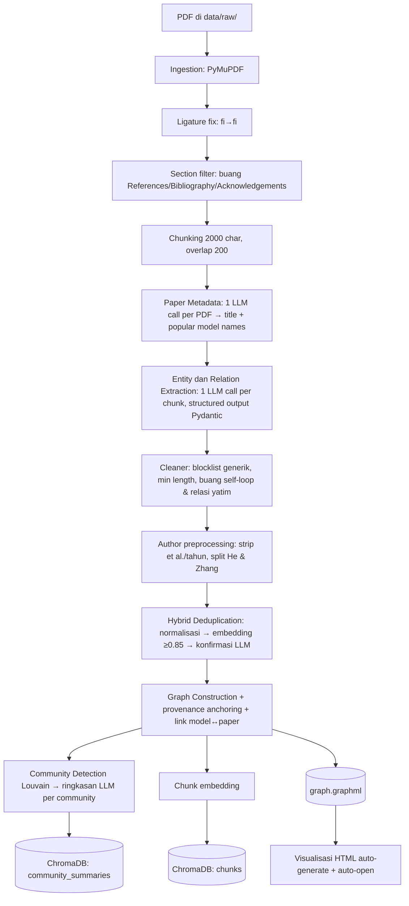
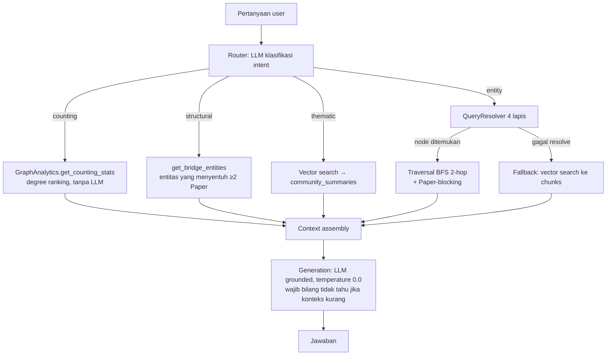

# GraphRAG Paper Explorer — Laporan Teknis Lengkap

> Sistem tanya-jawab akademik berbasis **Knowledge Graph + Vector Retrieval** di atas korpus paper
> computer vision, dengan visualisasi graf interaktif dan chatbot web.
> Constraint utama: **budget $0** (tanpa cloud berbayar, seluruh embedding berjalan lokal).

**Status akhir:** graph 258 node / 332 edge / 1 connected component / 0 isolated node.
Evaluasi: **retrieval 94%** (32/34), **end-to-end ~90–100%** (lihat §9), **anti-halusinasi 5/5**.

---

## 1. Latar Belakang & Masalah

### 1.1 Konteks

Proyek ini adalah **iterasi kedua** (V2.0) dari sebuah paper explorer. Versi pertama sudah bisa
mengekstrak isi paper menjadi graf, tetapi **tidak memiliki vector retrieval** sama sekali —
resolusi entitas murni leksikal (exact match + fuzzy string matching). V2.0 dibangun ulang
spesifik untuk **menggabungkan sisi graph dengan sisi vector (RAG)**.

Korpus saat ini: **5 paper arsitektur CNN klasik** (VGG, GoogLeNet, Highway Networks, ResNet,
DenseNet) → 94 chunk teks setelah section filtering.

### 1.2 Masalah yang ingin diselesaikan

Membaca dan mensintesis banyak paper secara manual itu mahal. Tiga jenis pertanyaan yang
**paling sering muncul saat literature review** justru paling sulit dijawab oleh sistem Q&A biasa:

| Jenis pertanyaan | Contoh | Kenapa sulit |
|---|---|---|
| **Agregatif** | "Metode apa yang paling banyak dipakai di seluruh korpus?" | Butuh menghitung seluruh korpus, bukan mengambil beberapa potongan teks |
| **Relasional** | "Arsitektur apa saja yang dibandingkan dengan VGG?" | Butuh relasi eksplisit, bukan kemiripan permukaan teks |
| **Multi-hop / lineage** | "Dari mana silsilah arsitektur GoogLeNet?" | Butuh menyusuri rantai relasi antar entitas |

**Vector RAG biasa buta terhadap ketiganya** karena ia hanya mengambil top-k chunk yang *mirip
secara semantik*, lalu menyerahkan sisanya ke LLM. Ia tidak punya representasi struktur.

### 1.3 Kenapa pendekatan graph

1. **Relasi menjadi first-class citizen.** `compares`, `builds_on`, `has_limitation` tersimpan
   sebagai edge bertipe — bisa ditelusuri, bukan ditebak dari teks.
2. **Agregasi deterministik.** Ranking "metode paling banyak dipakai" dihitung dari *degree*
   graf — **tanpa LLM**, jadi tidak bisa berhalusinasi.
3. **Multi-hop reasoning.** Rantai `GoogLeNet → Inception → Network in Network` bisa ditelusuri
   secara eksplisit.
4. **Explainability & provenance.** Setiap entitas tertaut ke Paper sumbernya, dan seluruh graf
   bisa **dilihat serta dijelajahi secara visual** — bukan black box.

Namun graph saja **tidak cukup** (pelajaran dari V1): kalau resolusi entitas gagal karena kata
yang dipakai user berbeda, sistem langsung buntu. Karena itu V2.0 bersifat **hybrid**.

---

## 2. Fungsi & Use Case

### 2.1 Kemampuan sistem

**A. Tanya-jawab (4 jalur retrieval berbeda, dipilih otomatis oleh router):**

| Intent | Untuk pertanyaan | Mesin yang dipakai |
|---|---|---|
| `entity` | Entitas spesifik & koneksinya | Resolver + graph traversal 2-hop |
| `counting` | Hitung / ranking | Statistik degree graf (**tanpa LLM**) |
| `structural` | Lintas-dokumen ("jembatan antar paper") | Analisis bridge entity |
| `thematic` | Tren / tema besar | Vector search ke ringkasan community |

**B. Visualisasi graf interaktif** (satu file HTML self-contained):
- Entity Types (legend + highlight per tipe)
- Network Insights (Top-5 per kategori berdasarkan degree)
- Edge Filters (filter per tipe relasi + deskripsi)
- Path Discovery (BFS shortest path antar dua node)
- Search bar + Info Panel (detail node, koneksi dikelompokkan, navigasi berantai)

**C. Chatbot web** — server FastAPI menyajikan visualisasi + endpoint `/api/chat`.

### 2.2 Target pengguna

- **Peneliti / mahasiswa** yang sedang melakukan literature review pada satu bidang.
- **Pembaca baru** di suatu domain yang butuh peta konsep: apa yang berkembang dari apa,
  siapa mengerjakan apa, dataset/metrik apa yang jadi standar.

### 2.3 Skenario pemakaian nyata

1. **Orientasi domain.** Buka visualisasi → lihat node besar (hub) → langsung tahu DenseNet,
   GoogLeNet, VGG adalah pusat percakapan, dan ImageNet adalah benchmark dominan.
2. **Menelusuri asal-usul ide.** Path Discovery: `Karen Simonyan → … → CIFAR-10` (5 hop),
   atau tanya "silsilah GoogLeNet" → `Inception → Network in Network`.
3. **Membandingkan klaim antar paper.** "Arsitektur apa yang dibandingkan dengan DenseNet?"
   → VGG, highway networks, ResNets, Network in Network.
4. **Mencari standar evaluasi.** "Metrik apa yang paling umum?" → top-5 error, Top-1 error.
5. **Cek atribusi.** "Institusi penulis paper ResNet?" → Microsoft Research (via
   Paper → Author → Institution).

---

## 3. Arsitektur & Alur Kerja (Pipeline)

Sistem terdiri dari **dua pipeline terpisah**: *build* (offline, sekali per korpus) dan
*query* (online, per pertanyaan).

### 3.1 Build Pipeline



**Tahapan detail:**

| # | Tahap | Detail penting |
|---|---|---|
| 1 | **Ingestion** | PyMuPDF; normalisasi ligature Unicode; section filter membuang References/Bibliography/Acknowledgements **sebelum** chunking (efek: 127 → 94 chunk, dan noise sitasi tidak masuk graph maupun vector store) |
| 2 | **Paper metadata** | 1 LLM call per PDF → `{title, models}`. Nama populer ("ResNet") diambil dari *world knowledge* LLM karena paper **tidak menyebut nama populernya sendiri**. Di-cache ke `paper_metadata.json` (resumable) |
| 3 | **Extraction** | 1 LLM call per chunk, **structured output** (Pydantic schema) + 9 STRICT RULES + injeksi judul paper. Temperature 0.1 |
| 4 | **Cleaning** | Blocklist entitas generik ("the model", "our approach"), min length, buang self-loop dan relasi yang endpoint-nya terbuang |
| 5 | **Author preprocessing** | Strip `" et al."` & tahun sitasi, pecah `"He & Zhang"` → dua author (relasi ikut di-fan-out) |
| 6 | **Deduplication** | 4 lapis (lihat §3.3) |
| 7 | **Graph construction** | Two-pass (node dulu, lalu edge) + provenance anchoring + link model↔paper + reclassify cited-paper |
| 8 | **Community + vector** | Louvain (Paper di-exclude) → ringkasan LLM → embed; semua chunk di-embed ke ChromaDB |

### 3.2 Query Pipeline



**Poin penting alur ini:** router memilih **mesin retrieval yang tepat per jenis pertanyaan**.
Untuk `counting`, LLM **tidak dilibatkan sama sekali** dalam menghitung — hanya untuk
memformulasikan jawaban akhir. Ini yang membuat jawaban kuantitatif tidak bisa berhalusinasi.

### 3.3 Hybrid Deduplication (4 lapis)

Duplikasi entitas adalah masalah terbesar dalam membangun KG dari teks
("DenseNet" vs "Dense Convolutional Network" vs "densenet").

```
Entity kandidat
  ├─ 0. Fast-lookup cache (sudah pernah diproses)          → O(1)
  ├─ 1. Exact match (case-sensitive)
  ├─ 2. Normalisasi (lowercase + strip punctuation + kamus akronim)   → tanpa LLM
  ├─ 3. Embedding cosine similarity ≥ 0.85 (lokal, per-tipe)          → kandidat
  └─ 4. Konfirmasi LLM (temperature 0.0) dengan guard CRITICAL 1 & 2
```

- **Namespace isolation**: entitas hanya dibandingkan dengan entitas **bertipe sama**.
- **CRITICAL 1**: dilarang menggabungkan entitas yang beda angka/versi
  (ResNet-44 ≠ ResNet-56, CIFAR-10 ≠ CIFAR-100, Top-1 ≠ Top-5).
- **CRITICAL 2**: dilarang *hypernymy* (memetakan yang spesifik ke yang lebih umum).
- **Checkpoint** disimpan setiap item → build bisa dilanjutkan kalau kuota harian habis.

### 3.4 Resolver 4 lapis (kunci sisi hybrid)

```
Query
  ├─ 0. Paper-context: jika query menyebut penulis/institusi/temuan + nama model
  │     → resolve ke node PAPER-nya (bukan node model)
  ├─ 1. Exact match (case-insensitive)
  ├─ 2. Nama node muncul verbatim di dalam query (whole-word, terpanjang menang)
  ├─ 3. Fuzzy match SequenceMatcher > 0.8
  └─ 4. Vector-native: nearest graph node by embedding (threshold 0.72)
       └─ gagal semua → fallback vector search ke chunks
```

Lapis 4 adalah inti "GraphRAG" versi ini: **vector dipakai untuk MASUK ke graph**, bukan untuk
menggantikan graph.

---

## 4. Struktur Graph

### 4.1 Schema (ontology)

**9 tipe node** (fixed, di-enforce lewat Pydantic `Literal`):

| Tipe | Makna | Jumlah aktual |
|---|---|---|
| `Paper` | Paper sumber di korpus | 5 |
| `Author` | Penulis paper ini | 28 |
| `Institution` | Universitas/lab/perusahaan | 13 |
| `Method` | Teknik, model, arsitektur, layer, algoritma | 130 |
| `Dataset` | Dataset bernama | 22 |
| `Metric` | Ukuran evaluasi | 15 |
| `Finding` | Temuan / klaim utama | 18 |
| `Limitation` | Kelemahan yang diakui penulis | 4 |
| `Task` | Problem yang dikerjakan | 23 |

**12 tipe relasi** (distribusi aktual):

| Relasi | Jumlah | Relasi | Jumlah |
|---|---|---|---|
| `mentioned_in` | 105 | `written_by` | 25 |
| `uses_dataset` | 57 | `affiliated_with` | 22 |
| `proposes_method` | 38 | `uses_metric` | 19 |
| `compares` | 31 | `uses_method` | 12 |
| `builds_on` | 11 | `finds` | 10 |
| `has_limitation` | 2 | `criticizes` | 0 |

> Catatan: `mentioned_in` mendominasi karena dipakai sebagai **provenance anchor**
> (setiap entitas ditautkan ke Paper sumbernya). Relasi ini **dikecualikan** dari perhitungan
> degree pada `counting` agar tidak menggelembungkan ranking.

### 4.2 Graph store — keputusan sadar

Sistem ini **tidak memakai graph database** (Neo4j/ArangoDB). Yang dipakai:

- **NetworkX** — graf in-memory
- **GraphML** — format persistensi (`data/processed/graph.graphml`)

**Alasan:** korpus target berukuran kecil-menengah (ratusan node), constraint $0 melarang
layanan berbayar, dan NetworkX sudah menyediakan semua algoritma yang dibutuhkan
(BFS, degree, connected components, Louvain) tanpa overhead server database.
**Trade-off** dibahas di §11.

### 4.3 Bagaimana graph di-query saat retrieval

| Kebutuhan | Implementasi |
|---|---|
| Entity lookup | Resolver 4 lapis (§3.4) |
| Konteks lokal | BFS `traverse(node, max_hops=2)` dengan **Paper-blocking** — node Paper dicatat sebagai provenance tapi **tidak diteruskan**, supaya konteks tidak meledak lewat hub; hasil dibatasi `max_rels=150` |
| Ranking / hitung | `get_counting_stats(type)` — degree per tipe, `mentioned_in` dikecualikan |
| Lintas-dokumen | `get_bridge_entities()` — entitas non-Paper yang bertetangga dengan ≥2 node Paper |
| Tematik | Louvain community → ringkasan → embedding di ChromaDB |
| Serialisasi konteks | Relasi diformat sebagai teks berlabel hop (`[hop 1] A --relasi--> B`) untuk LLM |

---

## 5. Teknologi (Stack) & Alasan Pemilihan

| Komponen | Teknologi | Alasan pemilihan |
|---|---|---|
| **LLM** | `google-genai` → **Gemini Flash Lite** (`gemini-flash-lite-latest`) | Free tier tanpa kartu kredit (constraint $0). Cukup untuk extraction terstruktur |
| **Structured output** | **Pydantic v2** + `response_schema` | Meng-enforce schema JSON di level API → tidak perlu parsing rapuh; `Literal` membatasi tipe entitas/relasi secara *constrained decoding* |
| **Embedding** | **sentence-transformers**, `BAAI/bge-small-en-v1.5` | Berjalan **lokal di CPU** → $0, tanpa limit request. Model kecil tapi kompetitif |
| **Vector store** | **ChromaDB** (PersistentClient) | Embedded, tanpa server, persist ke disk. Dua koleksi: `chunks` & `community_summaries` |
| **Graph** | **NetworkX** + GraphML | In-memory, algoritma lengkap, tanpa server DB (§4.2) |
| **Community detection** | `networkx.algorithms.community.louvain_communities` | Sudah built-in di NetworkX → tidak perlu dependensi `python-louvain` eksternal |
| **PDF parsing** | **PyMuPDF (fitz)** | Cepat, ekstraksi teks per halaman andal |
| **Visualisasi** | **Pyvis** (vis.js) + injeksi HTML/CSS/JS custom | Menghasilkan satu file HTML self-contained (`cdn_resources="in_line"`) → portabel, bisa dibuka tanpa server |
| **Web server** | **FastAPI + Uvicorn** | Ringan, async, cukup untuk 2 endpoint (`/`, `/api/chat`) |
| **Rate-limit handling** | **tenacity** | Retry exponential backoff; membedakan 429 transient vs kuota harian habis |
| **Fuzzy matching** | `difflib.SequenceMatcher` (stdlib) | Lapis resolver murah, tanpa dependensi tambahan |

**Prinsip desain yang mengikat semua pilihan:** *seluruh komputasi berulang (embedding, graph,
vector search) berjalan lokal dan gratis; LLM hanya dipakai untuk hal yang benar-benar butuh
pemahaman bahasa* (extraction, dedup confirmation, routing, generation).

---

## 6. Proses Pembangunan (Build Journey)

Pengembangan berlangsung bertahap. Yang menarik: **bagian yang paling banyak beriterasi bukan
arsitektur, melainkan kualitas ekstraksi dan resolusi entitas.**

### Fase 0 — Baseline
Pipeline dasar sudah jalan end-to-end (ingestion → extraction → dedup → graph → ChromaDB →
query), tetapi kualitas graf buruk: banyak node sampah, node melayang, dan tipe yang salah.

### Fase 1 — Perbaikan kualitas ekstraksi & graph (#1–#7)
Referensi utama: dokumen pengalaman dari proyek V1 (`TECHNICAL_REFERENCE.md`). Insight kunci:
**V2.0 dibangun ulang dari nol dan kehilangan hampir semua safeguard yang sudah susah payah
ditemukan di V1.** Yang di-port (dan diadaptasi ke schema baru):

| # | Perbaikan | Keputusan desain |
|---|---|---|
| 1 | Prompt ekstraksi: 2 baris → **9 STRICT RULES** | Rule "full name" diperhalus: **jangan** mengarang ekspansi untuk proper noun (ResNet/VGG sudah kanonik) |
| 2 | Section filter | Filter **fisik di full-text** (bukan hanya instruksi prompt) supaya graph & vector store memakai satu set chunk yang konsisten |
| 3 | Cleaner pasca-ekstraksi | Blocklist generik + min length; validasi tipe **tidak** diulang karena sudah dijamin Pydantic |
| 4 | Guard graph builder | `add_edge` NetworkX otomatis membuat node → **phantom node tanpa tipe**. Diperbaiki dengan two-pass |
| 5 | Guard dedup CRITICAL 1 & 2 | Prompt awal justru mendorong over-merging ("consider acronyms, variations") — berbahaya karena embedding memberi skor tinggi ke ResNet-44 vs ResNet-56 |
| 6 | Author preprocessing | Mekanis (regex), bukan LLM → deterministik & gratis |
| 7 | Strategi akronim | Ditemukan **bug laten**: value kamus berhuruf kapital sehingga tidak pernah match dengan key ter-lowercase → fast-path akronim **gagal total tanpa terdeteksi** |

### Fase 2 — Konektivitas (Phase A)
Diagnosis kuantitatif menemukan masalah struktural serius: **124 connected component,
118 node terisolasi, 130 node tanpa jalur ke Paper mana pun**, dan `source_chunk_id` kosong
di seluruh 321 node (provenance tidak pernah terisi).

**Akar masalah:** ekstraksi berjalan per-chunk, dan chunk di tengah paper jarang menyebut judul
paper → LLM tidak pernah membuat relasi yang menautkan entitas kembali ke Paper.

**Solusi:** provenance plumbing (`chunk_id` → `doc_id`) + satu Paper node kanonik per PDF +
`_connect_isolated_nodes` yang memaksa edge `mentioned_in`. **Hasil: 0 node terisolasi.**

### Fase 3 — Visualisasi & UI (Phase B & C)
Diimplementasikan dari dokumen desain V1 (`DESIGN_REFERENCE.md`), bertahap: physics
ForceAtlas2 + node sizing → legend/highlight → Network Insights → Edge Filters →
Path Discovery → Search → Info Panel. Seluruh UI **di-inject** ke output Pyvis
(`<style>` + HTML + `<script>` sebelum `</body>`), berkomunikasi dengan global vis.js
(`network`, `nodes`, `edges`).

Iterasi paling banyak di sini adalah **feedback visual** (glow highlight): beberapa putaran
sampai "bersinar" benar-benar terlihat — blur shadow yang terlalu besar justru menyebarkan
cahaya sehingga tak terlihat.

### Fase 4 — Chatbot web
Menambahkan `server.py` (FastAPI): `GET /` menyajikan visualisasi, `POST /api/chat` memakai
**pipeline query yang sama** dengan CLI. Engine dimuat sekali saat startup (cache).

### Fase 5 — Perbaikan retrieval (#8, multi-hop, structural)
Ditemukan lewat pengujian manual: pertanyaan *"Arsitektur apa yang dibandingkan dengan VGG?"*
dijawab dari **chunk teks**, bukan graph (terlihat dari jawaban yang menyebut "Tabel 3, Tabel 4").
Artinya banyak pertanyaan `entity` **diam-diam turun kelas menjadi RAG biasa** karena resolver
gagal → fallback vector.

**Perbaikan:** resolver 4 lapis (§3.4), traversal 2-hop, intent `structural` baru.

### Fase 6 — Paper linking (B1 + B2)
Pertanyaan atribut paper ("institusi penulis paper VGG") gagal karena tiga hal bertumpuk:
nama populer ("VGG") adalah node terpisah dari node Paper, **terputus** dari paper-nya, dan
VGG salah bertipe `Institution`.

**Insight kunci:** paper **tidak pernah menyebut nama populernya sendiri** — paper VGG menyebut
dirinya "ConvNet Configuration D/E", paper ResNet menyebut "residual learning framework".
Jadi link nama-populer → paper **tidak mungkin** didapat dari teks; harus dari pengetahuan luar.

**Solusi:** B1 = injeksi judul paper ke prompt ekstraksi; B2 = link deterministik model↔paper +
resolver paper-context.

### Fase 7 — De-hardcoding (mitigasi overfitting)
Audit menemukan dua titik yang "menghafal" korpus: `PAPER_METADATA` (5 nama file → judul + model)
dan `KNOWN_ACRONYMS`. Keduanya diganti dengan **auto-generate saat build**:
- Metadata paper → 1 LLM call per PDF, di-cache ke JSON.
- Akronim → regex `Full Name (ACR)` dari teks paper sendiri (validasi inisial), dengan kamus
  statis sebagai *seed* saja.

**Hasil:** tambahkan PDF baru → rebuild → judul, nama model, dan akronim terisi otomatis
**tanpa mengubah kode**.

### Fase 8 — Evaluasi & pembersihan akhir
Membangun harness evaluasi (§9), normalisasi ligature, reclassify cited-paper
(`Network in Network` yang bocor sebagai Paper → Method).

### Bagian yang paling banyak berubah

1. **Prompt ekstraksi** — dari 2 baris jadi 9 rules + injeksi judul (≥4 iterasi).
2. **Deduplication** — threshold, namespace, guard CRITICAL, bug casing akronim, auto-acronym.
3. **Resolver** — dari 2 lapis leksikal → 4 lapis + paper-context (2 iterasi besar).
4. **Visualizer** — dari ~48 baris menjadi >1000 baris (Phase B, C, tema, chatbot).

---

## 7. Value

### 7.1 Untuk pengguna

| Value | Bukti konkret |
|---|---|
| **Menjawab pertanyaan yang RAG biasa tidak bisa** | Agregasi ("metode paling banyak dipakai"), lintas-dokumen ("jembatan antar paper"), lineage (`GoogLeNet → Inception → NiN`) |
| **Jawaban kuantitatif yang tidak bisa berhalusinasi** | Ranking dihitung dari degree graf, LLM tidak ikut menghitung |
| **Peta konsep yang bisa dijelajahi** | Visualisasi interaktif: 258 node, hub terlihat dari ukuran, Path Discovery untuk menelusuri koneksi |
| **Provenance / atribusi jelas** | Setiap entitas tertaut ke Paper sumbernya (`mentioned_in`, atribut `source_paper`) |
| **Kejujuran (anti-halusinasi)** | 5/5 pertanyaan tak terjawab **ditolak** dengan benar, bahkan ketika node relevan berhasil di-resolve |
| **Menghemat waktu orientasi** | Struktur korpus (siapa membandingkan siapa, dataset standar) terlihat tanpa membaca 5 paper penuh |

### 7.2 Untuk organisasi / pembelajaran

- **Reproducible & $0**: seluruh pipeline berjalan di laptop tanpa biaya cloud.
- **Resumable**: checkpoint per-chunk → build tahan terhadap kuota harian yang habis.
- **Measurable**: harness evaluasi membuat setiap perubahan bisa diukur (before/after),
  bukan berdasarkan kesan.
- **Extensible**: tambah PDF → rebuild → metadata & akronim otomatis.

---

## 8. Kelebihan & Kekurangan Dibanding RAG Biasa

### 8.1 Perbandingan teknis langsung

| Kemampuan | RAG biasa (vector-only) | Graph-only (V1) | **GraphRAG (proyek ini)** |
|---|---|---|---|
| Faktoid dari teks | ✅ Kuat | ⚠️ Tergantung ekstraksi | ✅ (graph + fallback chunk) |
| Tahan parafrase | ✅ Kuat | ❌ Rapuh (leksikal) | ✅ (embedding resolver) |
| Relasi antar entitas | ❌ Hanya kemiripan permukaan | ✅ Kuat | ✅ Kuat |
| **Agregasi / counting** | ❌ Tidak bisa | ✅ | ✅ Deterministik |
| **Multi-hop reasoning** | ❌ Tidak bisa | ✅ (terbatas) | ✅ 2-hop |
| **Query lintas-dokumen** | ❌ | ⚠️ Manual | ✅ `structural` intent |
| **Tematik / global** | ⚠️ Lemah | ❌ | ⚠️ Ada, tapi kasar (§11) |
| Explainability | ❌ Hanya teks | ✅ Graf | ✅ Graf + visual interaktif |
| Provenance | ⚠️ Chunk id | ✅ | ✅ Entity → Paper |

### 8.2 Studi kasus nyata: pertanyaan yang sama, dua jalur berbeda

**Query:** *"Arsitektur apa saja yang dibandingkan dengan VGG?"*

| Jalur | Output | Analisis |
|---|---|---|
| **Vector (RAG biasa)** — sebelum resolver diperbaiki | "GoogLeNet, PReLU-net, BN-inception, ResNet-34/50/101/152, plain-34, DenseNet-BC … **(Tabel 3, Tabel 4, Tabel 5)**" | Datang dari **tabel di paper ResNet**. Kaya detail, tapi tidak terstruktur, dan mencampur sudut pandang paper lain. Referensi "Tabel 3/4/5" adalah tanda jawaban berasal dari teks mentah |
| **Graph (setelah #8)** | "GoogLeNet, Clarifai, MSRA, Zeiler & Fergus, OverFeat" | Datang dari edge `compares` — yaitu perbandingan **yang dinyatakan paper VGG sendiri** (kompetitor ILSVRC-2014). Eksplisit, bisa ditelusuri, bisa divisualisasikan |

**Pelajaran penting:** keduanya "benar" tetapi menjawab dari **sumber berbeda**. Nilai GraphRAG
adalah jawaban yang **terstruktur dan traceable**; nilai vector adalah **cakupan teks mentah**.
Sistem ini memakai graph lebih dulu, dan vector sebagai jaring pengaman.

### 8.3 Trade-off (jujur)

| Aspek | RAG biasa | GraphRAG (proyek ini) |
|---|---|---|
| **Biaya build** | Murah — hanya embed chunk (lokal, gratis) | Mahal — ~94 LLM call ekstraksi + call dedup + 5 call metadata + ringkasan community |
| **Waktu build** | Detik–menit | Puluhan menit (didominasi rate-limit free tier 6 s/call) |
| **Kompleksitas kode** | Rendah (~200 baris) | Tinggi (~3.500 baris, 15+ modul) |
| **Titik gagal** | Sedikit | Banyak: ekstraksi → dedup → routing → resolusi |
| **Garbage in, garbage out** | Tidak berlaku (teks mentah) | **Sangat berlaku** — kualitas graf = kualitas ekstraksi LLM |
| **Latency query** | 1 embed + 1 LLM call | 2 LLM call (router + generation) + retrieval lokal |
| **Maintenance** | Rendah | Perlu perhatian pada schema & kualitas dedup |

**Kesimpulan trade-off:** GraphRAG **tidak selalu lebih baik**. Untuk pertanyaan faktoid
sederhana, RAG biasa sudah cukup dan jauh lebih murah. GraphRAG terbayar ketika pertanyaannya
**relasional, agregatif, atau multi-hop** — dan ketika **explainability** dibutuhkan.

---

## 9. Evaluasi & Hasil

### 9.1 Desain harness

Evaluasi dibuat **dua level** (`evaluate.py`, 44 test case di `eval/eval_cases.json`):

| Mode | Yang diukur | Biaya | Sifat |
|---|---|---|---|
| `python evaluate.py` (**retrieval**) | Apakah graph **punya & mengambil** fakta yang benar (resolver + traversal + analytics), dengan intent diketahui | **Gratis** (tanpa LLM) | Deterministik — mengisolasi kualitas graf |
| `python evaluate.py --e2e` | Pipeline utuh: **router + retrieval + generation + anti-halusinasi** | Pakai kuota | Realistis, tapi lebih noisy |

**Kenapa dipisah:** retrieval mode mengukur inti GraphRAG tanpa kontaminasi variabilitas LLM,
dan bisa dijalankan sesering mungkin sebagai **regression test**.

### 9.2 Komposisi test case (44 total)

| Kategori | Jumlah | Contoh |
|---|---|---|
| `paper-attr` | 10 | "Institusi penulis paper ResNet?" |
| `relational` | 8 | "Apa kelemahan GoogLeNet?" |
| `negative` | 8 | "Berapa harga GPU untuk melatih VGG?" (harus **menolak**) |
| `adversarial` | 7 | Multi-entitas, 3-hop, negasi, subjektif |
| `counting` | 5 | "Metrik apa yang paling umum?" |
| `multihop` | 2 | "Silsilah GoogLeNet?" |
| `structural` | 2 | "Jembatan antar paper?" |
| `resolution` | 2 | Parafrase tanpa nama node verbatim |

### 9.3 Hasil

**A. Retrieval accuracy — 32/34 = 94%**

| Kategori | Skor |
|---|---|
| counting | 5/5 ✅ |
| relational | 8/8 ✅ |
| multihop | 2/2 ✅ |
| paper-attr | 10/10 ✅ |
| resolution | 2/2 ✅ |
| structural | 2/2 ✅ |
| **adversarial** | **3/5** ⚠️ |

**B. End-to-end — 18/20 = 90% mentah → efektif 100%**

> ⚠️ **Disclosure penting:** angka e2e ini dijalankan pada set **20 case versi lebih awal**,
> bukan pada 44 case final. Dari 2 kegagalan, **keduanya adalah false failure**:
> 1. `count-method2` — sistem menjawab "DenseNet dengan 21 koneksi" (**benar**), tapi test case
>    mengharapkan kata "GoogLeNet" (peringkat #2). LLM hanya menyebut peringkat teratas.
> 2. `struct-bridge` — sistem menjawab "top-5 error, ImageNet…" (**benar**), tapi test case masih
>    memakai ekspektasi lama ("Inception") yang **sudah tidak valid** setelah perbaikan
>    reclassify cited-paper.
>
> Setelah kedua ekspektasi dikoreksi ke fakta yang benar, **efektif 20/20**.

**C. Sub-metrik dari run e2e (paling penting):**

| Metrik | Hasil |
|---|---|
| **Router accuracy** (klasifikasi intent) | **20/20 = 100%** — counting, entity, structural, paper-context semua benar |
| **Anti-halusinasi** (kasus negatif) | **5/5 = 100%** menolak dengan benar |
| Paper-context resolution | 4/4 — "paper VGG/ResNet/DenseNet" resolve ke node **Paper**, bukan node model |

Contoh perilaku anti-halusinasi yang paling meyakinkan: pada *"Tahun berapa paper ResNet
dipublikasikan?"* sistem **berhasil** resolve ke node paper ResNet, mendapat konteks 19.893
karakter, tetapi **tetap menjawab "tidak tahu"** karena tahun publikasi tidak ada dalam konteks —
bukti bahwa generation benar-benar *grounded*, bukan memakai pengetahuan internal LLM.

**D. Latency (diukur, bukan estimasi)**

| Operasi | Waktu | Catatan |
|---|---|---|
| Startup (load embedding model + Chroma + graph) | **~28 s** | Sekali per proses; server men-cache-nya |
| Retrieval entity (resolver lapis 1–3 + traversal 2-hop) | **~4 ms** | Rata-rata 4 query; dominan graph lookup |
| Resolver lapis 4 (embedding) — pertama kali | **~8,2 s** | Meng-embed 258 nama node sekali (cache) |
| Resolver lapis 4 — setelah cache | **~0,5 s** | |
| `counting` (degree ranking) | **~1 ms** | |
| `structural` (bridge entities) | **~0,2 ms** | |
| Vector search ChromaDB | **~0,49 s** | |
| **LLM call (router / generation)** | **~6–8 s per call** | **Didominasi `time.sleep(6.0)`** untuk mematuhi rate limit free tier — bukan batas komputasi |

**Kesimpulan latency:** retrieval sisi graph **hampir gratis secara komputasi** (milidetik).
Latency end-to-end (~13–16 s per pertanyaan) **hampir seluruhnya berasal dari rate limiting
free tier LLM** (2 call per query). Dengan paid tier, latency akan turun drastis tanpa
perubahan arsitektur.

**E. Statistik graf (kualitas struktur)**

| Metrik | Sebelum perbaikan | Sesudah |
|---|---|---|
| Node | 321 | 258 |
| Connected component | **124** | **1** |
| Node terisolasi | **118** | **0** |
| Node tanpa jalur ke Paper | 130 | 0 |
| Node `Paper` | 6 (termasuk paper sitasi) | **5** (tepat jumlah paper sumber) |
| Provenance terisi | 0/321 | seluruh node |

### 9.4 Contoh query nyata & output

| Query | Intent terpilih | Output (ringkas) |
|---|---|---|
| "Metode apa yang paling banyak dipakai?" | `counting` | DenseNet (21), GoogLeNet, VGG |
| "Dataset apa yang digunakan ResNet?" | `entity` → traversal | ImageNet, CIFAR-10, MNIST |
| "Apa kelemahan GoogLeNet?" | `entity` → traversal | memory usage |
| "Dari mana silsilah GoogLeNet?" | `entity` → 2-hop | GoogLeNet → Inception → Network in Network |
| "Institusi penulis paper VGG?" | `entity` → paper-context | Visual Geometry Group, University of Oxford |
| "Entitas apa yang menjadi jembatan antar paper?" | `structural` | top-5 error (4 paper), ImageNet (3), CIFAR-10 (2) |
| "Berapa harga GPU untuk melatih VGG?" | `entity` | *"tidak tahu berdasarkan dokumen"* ✅ |

### 9.5 Batas validitas evaluasi (disclosure)

Agar tidak overclaim:
- **Sampel kecil** (44 case) — cukup untuk regression test & demo, **bukan** benchmark akademik.
- **Test case dibuat manual** oleh pengembang → ada *selection bias*.
- **Penilaian berbasis keyword matching** pada prosa LLM → rapuh; bisa menghasilkan
  *false failure* (terbukti terjadi 2×).
- **Tidak ada precision/recall formal** — metrik yang dipakai adalah *accuracy* pada
  set terkurasi, bukan pada ground truth berlabel independen.
- Angka e2e berasal dari set 20 case versi lebih awal (§9.3B).

---

## 10. Tantangan & Solusi

| # | Tantangan | Akar masalah | Solusi |
|---|---|---|---|
| 1 | **118 node melayang, graf pecah 124 komponen** | Ekstraksi per-chunk; chunk tengah paper tidak menyebut judul → tidak ada relasi ke Paper | Provenance plumbing + Paper node kanonik per PDF + forced edge `mentioned_in` → 0 isolated |
| 2 | **Phantom node tanpa tipe** | `NetworkX.add_edge` otomatis membuat node kalau endpoint belum ada | Graph builder **two-pass**: semua node entitas dulu, lalu edge hanya bila kedua endpoint ada |
| 3 | **Fast-path akronim gagal total tanpa terdeteksi** | Value kamus berhuruf kapital (`"Batch Normalization"`) tidak pernah match key ter-lowercase | `_normalize_base()` menormalkan **kedua** sisi → "BN" dan "Batch Normalization" collapse ke key sama |
| 4 | **Risiko over-merging saat dedup** | Prompt awal justru menyuruh "consider acronyms, variations", sementara embedding memberi skor tinggi ke ResNet-44 vs ResNet-56 | Guard **CRITICAL 1** (beda angka/versi) & **CRITICAL 2** (anti-hypernymy) |
| 5 | **Pertanyaan entity diam-diam dijawab RAG biasa** | Resolver mencocokkan **seluruh kalimat** query → gagal → fallback vector | Resolver 4 lapis: + *node-name-in-query* + *embedding nearest node* |
| 6 | **Threshold embedding memicu false match** | Threshold 0.62 masih di dalam noise floor bge-small | Diagnostik terukur: parafrase asli 0,72–0,97 vs noise 0,54–0,64 → threshold **0,72** |
| 7 | **Atribut paper tidak terjawab** ("institusi penulis VGG") | Nama populer ("VGG") adalah node terpisah & **terputus** dari node Paper; VGG salah bertipe `Institution` | B1 injeksi judul + B2 link model↔paper + resolver paper-context. Terbukti: embedding **tidak bisa** menutup gap ini (VGG→paper hanya 0,52) |
| 8 | **Overfitting: metadata & akronim di-hardcode** | Peta 5 nama file dan kamus akronim statis | Auto-generate saat build: 1 LLM call/PDF + regex `Full Name (ACR)` dari teks korpus |
| 9 | **Kuota harian free tier habis di tengah build** | 94+ LLM call, limit harian | Checkpoint **per-chunk** + `DailyQuotaExceededError` yang tidak di-retry → build resumable |
| 10 | **Crash `UnicodeEncodeError` saat menulis HTML** | Pyvis `write_html` memakai encoding OS default (cp1252 di Windows) | `generate_html()` → tulis manual sebagai UTF-8 |
| 11 | **Artefak ligature di nama node** (`classification`) | Glyph ligature Unicode di teks PDF | Normalisasi `fi→fi` dll. di ingestion, sebelum chunking |
| 12 | **Paper sitasi bocor sebagai node `Paper`** | LLM mengekstrak "Network in Network" sebagai Paper | `reclassify_noncanonical_papers()` — hanya judul di metadata yang tetap `Paper` |
| 13 | **Konteks membengkak setelah paper jadi hub** | Cap traversal `max_nodes` ter-hit sebelum hop-2 → afiliasi (Paper→Author→Institution) terputus | Cap diganti `max_rels=150`; kedua hop **selalu** dijalankan |
| 14 | **Glow highlight tidak terlihat** | Shadow blur terlalu besar (65) → cahaya tersebar terlalu tipis | Blur diperkecil (30) + node diperbesar 1,4× + fill dicerahkan, tanpa border |

---

## 11. Limitasi & Rencana Lanjut

### 11.1 Limitasi terukur (ditemukan lewat adversarial test)

| Limitasi | Bukti | Dampak |
|---|---|---|
| **Resolusi entitas tunggal** | `adv-multi-entity`: "institusi penulis paper ResNet **dan** DenseNet" → hanya resolve ResNet (dapat Microsoft, tidak dapat Cornell) | Pertanyaan multi-entitas dijawab **sebagian** |
| **Plafon traversal 2-hop** | `adv-3hop`: "institusi penulis arsitektur yang dibandingkan GoogLeNet" (butuh 3+ hop) gagal | Penalaran rantai panjang tidak didukung |

### 11.2 Limitasi arsitektural & kualitas

| Limitasi | Penjelasan |
|---|---|
| **Terikat schema** | Pertanyaan yang butuh relasi di luar 12 tipe **tidak akan terjawab**. Contoh nyata: *"Metode apa yang mengatasi kelemahan X?"* butuh relasi `solves/addresses` yang tidak ada → sistem benar menjawab "tidak tahu" |
| **Jalur `thematic` paling lemah** | Louvain menghasilkan **163 community** yang sangat terfragmentasi (hanya 17 diringkas); sebagian koheren (penulis GoogLeNet, komponen layer), sebagian campur-aduk. Korpus 5 paper terlalu kecil untuk community yang bersih |
| **Residu deduplikasi** | `C10` vs `CIFAR-10` masih terpisah; `top-1` vs `top-1 error` duplikat semantik. Sengaja tidak di-hardcode |
| **Bridge entity kadang noisy** | "top-5 error" muncul sebagai jembatan utama — benar secara struktural, tapi kurang bermakna dibanding "ImageNet" |
| **Embedding model English-only** | `bge-small-en-v1.5`. Terukur: parafrase Indonesia *"arsitektur dengan koneksi lompat antar lapisan"* **gagal** menembus threshold (jatuh ke fallback chunk), sedangkan padanan Inggris berhasil. Query Indonesia lebih bergantung pada lapis leksikal |
| **Tidak scalable ke korpus besar** | Semua in-memory: graf NetworkX, embedding seluruh nama node per proses, satu file HTML. Untuk ratusan paper (ribuan node) → dedup membengkak (O(n²) per tipe), HTML berat, kuota build tidak cukup |
| **Kualitas = kualitas ekstraksi** | Model `flash-lite` (paling lemah, dipilih karena free tier). Tidak ada mekanisme koreksi downstream |
| **Fallback vector belum hybrid** | Fallback chunk hanya menyala saat resolver **gagal**, bukan saat konteks graph tidak lengkap |
| **Tidak ada automated test suite** | Pengujian mengandalkan harness evaluasi + verifikasi manual; regresi kode bisa lolos |
| **Keamanan** | `.env` sempat ter-track dan **masih ada di git history pada remote publik** → API key lama harus dianggap bocor (sudah di-untrack; rotasi key belum dilakukan) |

### 11.3 Rencana lanjut (prioritas)

**Jangka pendek (query-time, tanpa rebuild):**
1. **Multi-entity resolution** — ekstrak >1 entitas dari query → traversal multi-node → merge konteks.
2. **Hybrid graph+vector context** — selalu sertakan top-k chunk sebagai pelengkap konteks graph,
   supaya "ter-resolve tapi atribut tidak ada di graf" tidak langsung menjadi "tidak tahu".
3. **Rotasi API key** + pertimbangkan purge git history.

**Jangka menengah (butuh rebuild):**
4. **Traversal adaptif 3-hop** dengan penyaringan relevansi (agar konteks tidak meledak).
5. **Perbaikan community/thematic** — resolusi Louvain di-tuning, atau ringkasan hierarkis
   (community besar saja), sehingga jalur `thematic` layak dipakai.
6. **Model ekstraksi lebih kuat** untuk mengurangi misatribusi (trade-off: kuota).
7. **Relasi baru** (`addresses`, `improves_on`) bila pertanyaan "mengatasi kelemahan" dianggap penting.

**Jangka panjang (arsitektural):**
8. **Skalabilitas** — indeks embedding node persisten (ChromaDB alih-alih in-memory),
   blocking/LSH untuk dedup, dan visualisasi progresif/paginated.
9. **Graph database** (Neo4j) bila korpus tumbuh ke ribuan node dan butuh query Cypher.
10. **Evaluasi yang lebih kuat** — perbanyak test case, LLM-as-judge alih-alih keyword matching,
    dan ground truth berlabel independen agar bisa melaporkan precision/recall.

---

## Lampiran A — Struktur Direktori

```
PaperVisualizerV2.0-GraphRAG/
├── main.py                       # CLI: build & query
├── server.py                     # FastAPI: visualisasi + /api/chat
├── evaluate.py                   # Harness evaluasi (retrieval & --e2e)
├── eval/eval_cases.json          # 44 test case
├── data/
│   ├── raw/                      # PDF input (5 paper)
│   └── processed/
│       ├── graph.graphml         # Knowledge graph final
│       ├── chroma_db/            # Vector store (chunks + community_summaries)
│       ├── paper_metadata.json   # Auto-generated: title + popular model names
│       ├── graph_visualization.html
│       └── similarity_debug.csv  # Log diagnostik dedup
└── src/
    ├── config.py                 # Schema Pydantic, konstanta, loader metadata
    ├── engine.py                 # Orchestrator query (router → retrieval → generation)
    ├── ingestion/document.py     # PDF parsing, ligature fix, section filter, chunking
    ├── extraction/
    │   ├── extractor.py          # Wrapper ekstraksi
    │   ├── cleaner.py            # Validasi + author preprocessing
    │   └── deduplicator.py       # Hybrid dedup 4 lapis + auto-acronym
    ├── graph/
    │   ├── builder.py            # Konstruksi graf + provenance + paper linking
    │   ├── analytics.py          # Counting, bridge entities, Louvain
    │   └── visualizer.py         # Pyvis + injeksi UI (Phase B & C)
    ├── llm/
    │   ├── gemini_client.py      # Semua LLM call + retry/quota handling
    │   └── embedding.py          # Embedding lokal (bge-small-en-v1.5)
    ├── query/
    │   ├── router.py             # Klasifikasi intent
    │   ├── resolver.py           # Resolver 4 lapis
    │   └── traversal.py          # BFS multi-hop + Paper-blocking
    └── vectorstore/chromadb_store.py
```

## Lampiran B — Cara Menjalankan

```bash
# 1. Build (sekali per korpus; resumable jika kuota habis)
python main.py build
#    → otomatis generate + membuka visualisasi HTML di akhir

# 2. Query via CLI
python main.py query --query "Metode apa yang paling banyak dipakai?"

# 3. Web (visualisasi + chatbot)
python server.py          # → http://127.0.0.1:8000
#    NOTE: restart server setiap kali graph di-rebuild atau kode diubah (engine di-cache)

# 4. Evaluasi
python evaluate.py        # retrieval — gratis, tanpa LLM
python evaluate.py --e2e  # end-to-end — memakai kuota LLM
```

## Lampiran C — Ringkasan Angka Kunci

| Metrik | Nilai |
|---|---|
| Korpus | 5 PDF → 94 chunk |
| Graph | 258 node, 332 edge, 1 component, 0 isolated |
| Schema | 9 tipe node, 12 tipe relasi |
| Test case evaluasi | 44 (8 kategori, termasuk 8 negatif + 7 adversarial) |
| Retrieval accuracy | **32/34 = 94%** |
| End-to-end accuracy | **18/20 = 90%** mentah → efektif 100% (§9.3B) |
| Router accuracy | **20/20 = 100%** |
| Anti-halusinasi | **5/5 = 100%** |
| Latency retrieval graph | ~4 ms (warm) |
| Latency end-to-end | ~13–16 s (didominasi rate limit free tier) |
| Baris kode | ~3.500 |
| Biaya operasional | **$0** |
